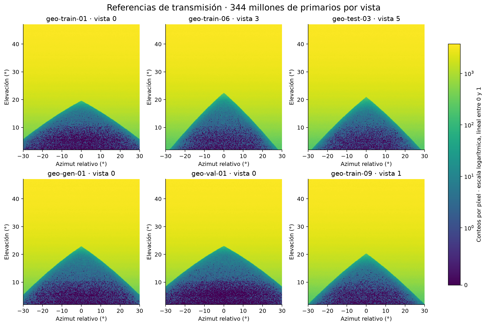
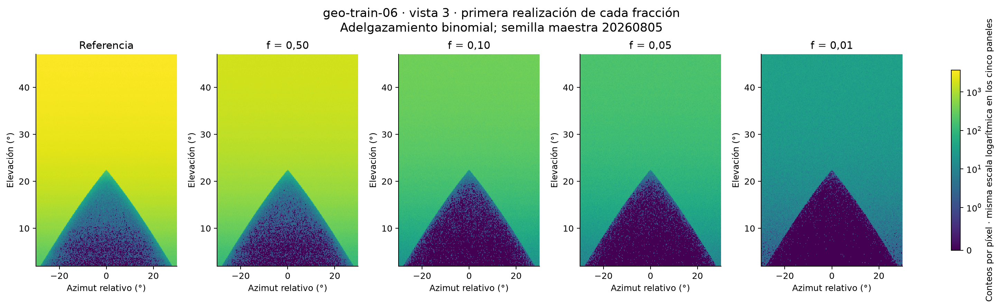
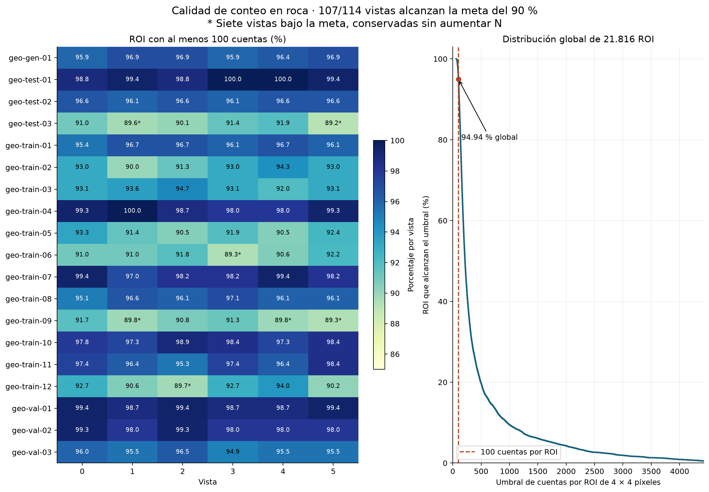
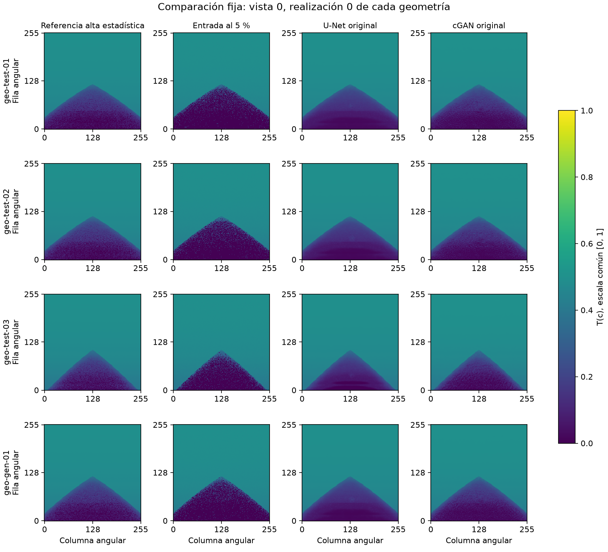
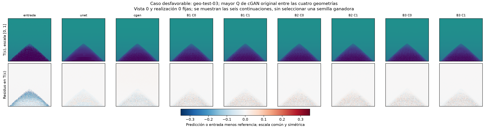
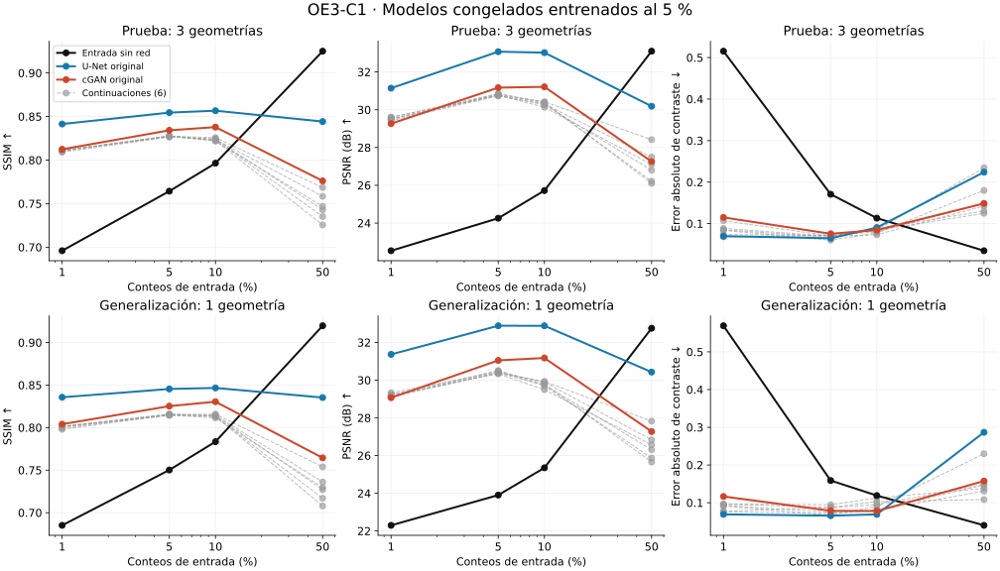

# 4. Resultados

Los resultados corresponden a productos y modelos congelados. Las cifras se separan por objetivo y partición, sin trasladar resultados de campañas históricas a la campaña corregida. Las tablas 4.1–4.3 se transcriben programáticamente desde la [síntesis auditada](../objetivo-3/evidencias/revision-complemento-c1/sintesis_metricas.csv); el redondeo es editorial y no modifica las decisiones.

## 4.1. Conjunto sintético obtenido

Se obtuvieron 114 referencias y 9.120 pares, distribuidos por geometría en entrenamiento (12), validación (3), prueba (3) y generalización (1). Se verificaron 477 huellas de fusión/exportación y se reprodujeron las 342 huellas de contenido de los pares. La revisión reproduce el posproceso, no una segunda campaña Geant4.

La Figura 4.1 presenta referencias de diferentes escenarios, incluidas vistas bajo la meta descriptiva de roca.

**Figura 4.1.** Conteos por píxel sobre coordenadas angulares, con escala común logarítmica, lineal entre cero y una cuenta. La selección ilustra configuraciones; no es una muestra estadística de volcanes. Fuente: [síntesis OE1](../objetivo-1/SINTESIS_RESULTADOS_OE1.md).

La Figura 4.2 permite observar la reducción de conteos de una misma referencia y las cuatro fracciones disponibles.

**Figura 4.2.** geo-train-06, vista 3, primera realización por fracción. Conteos sin renormalizar por f y escala común. Las imágenes comparten referencia finita y no corresponden a cinco transportes independientes.

Las 1.710 regiones de borde satisficieron el criterio fijado. En roca, 20.713 de 21.816 ROI alcanzaron cien cuentas (94,944 %). La meta del 90 % de ROI se cumplió en 107/114 vistas. Las siete excepciones permanecen en el conjunto: geo-test-03, vistas 1 y 5; geo-train-06, vista 3; geo-train-09, vistas 1, 4 y 5; geo-train-12, vista 2. Sus porcentajes oscilan entre 89,19 % y 89,81 %. La Figura 4.3 conserva esa distinción por vista.

**Figura 4.3.** Cumplimiento de cien cuentas por ROI y distribución agregada. El porcentaje global no reemplaza el indicador individual ni demuestra precisión del 10 % por píxel. La escala horizontal del panel agregado se limita al percentil 99,5 para lectura; el cálculo utiliza todas las ROI.

Estos resultados sustentan el producto del OE1 dentro del alcance idealizado aceptado. No demuestran flujo calibrado ni equivalencia instrumental.

## 4.2. Evaluación al 5 % de conteos

La Tabla 4.1 incluye la entrada y todos los modelos. SSIM/PSNR se calculan en la representación T y Q después de recuperar cuentas. Por ello sus valores responden a aspectos distintos de calidad.

**Tabla 4.1.** Resultados al 5 %, conservando todos los modelos y ambas particiones.

| Partición | Modelo | SSIM | PSNR (dB) | Q (%) |
|---|---|---|---|---|
| Prueba | entrada | 0.7643 | 24.2575 | 1.832 |
| Prueba | unet_original | 0.8545 | 33.0739 | 22.388 |
| Prueba | cgan_original | 0.8342 | 31.1699 | 14.566 |
| Prueba | B1_C0 | 0.8277 | 30.8391 | 5.825 |
| Prueba | B1_C1 | 0.8278 | 30.8489 | 4.821 |
| Prueba | B2_C0 | 0.8274 | 30.7719 | 3.996 |
| Prueba | B2_C1 | 0.8273 | 30.7701 | 4.727 |
| Prueba | B3_C0 | 0.8263 | 30.7288 | 4.828 |
| Prueba | B3_C1 | 0.8273 | 30.7680 | 5.480 |
| Generalización | entrada | 0.7502 | 23.9036 | 1.093 |
| Generalización | unet_original | 0.8454 | 32.8834 | 26.505 |
| Generalización | cgan_original | 0.8252 | 31.0474 | 16.959 |
| Generalización | B1_C0 | 0.8161 | 30.4846 | 3.808 |
| Generalización | B1_C1 | 0.8151 | 30.5088 | 4.323 |
| Generalización | B2_C0 | 0.8145 | 30.3311 | 4.131 |
| Generalización | B2_C1 | 0.8154 | 30.4032 | 4.755 |
| Generalización | B3_C0 | 0.8149 | 30.4042 | 4.054 |
| Generalización | B3_C1 | 0.8146 | 30.3715 | 2.271 |

En prueba, cGAN mejora SSIM de 0,7643 a 0,8342 y PSNR de 24,258 a 31,170 dB. U-Net alcanza mayor similitud, con 0,8545 y 33,074 dB. Sin embargo, Q aumenta de 1,832 % en la entrada a 14,566 % con cGAN y 22,388 % con U-Net. Las seis continuaciones reducen parte del sesgo de las redes originales, aunque Q permanece por encima de la entrada. No se identifica una variante que resuelva simultáneamente todas las discrepancias.

La Figura 4.4 muestra casos fijados por índice, con escala común; permite comparar apariencia sin escoger retrospectivamente la mejor imagen.

**Figura 4.4.** Vista 0 y realización 0 de cada geometría. Los dieciséis paneles comparten escala T(c). Los ejes son índices de píxel angular, no distancias. Fuente: [informe OE2](../objetivo-2/manuscrito/INFORME_OE2.md).

La Figura 4.5 muestra una limitación: se eligió geo-test-03 por tener el mayor Q de cGAN entre las cuatro geometrías, conservando vista y realización cero.

**Figura 4.5.** Comparación de los ocho modelos y diferencias en T(c), con escala simétrica común. Q = 27,835 % corresponde a toda la geometría, no a un panel. La selección es descriptiva y posterior a la evaluación, no una nueva prueba independiente.

## 4.3. Transferencia a otras fracciones

El complemento recibió 96 matrices nuevas y 11.520 predicciones. Se comprobaron sus huellas y se recalcularon las métricas completas junto con el bloque al 5 %. La máxima diferencia absoluta numérica fue 7,105 × 10⁻¹⁵. Esta coincidencia acredita el recálculo sobre las matrices, sin afirmar que se repitió localmente toda la inferencia GPU.

La Tabla 4.2 muestra cGAN original; la [tabla completa](../objetivo-3/evidencias/revision-complemento-c1/sintesis_metricas.csv) conserva las otras variantes.

**Tabla 4.2.** cGAN original en las cuatro estadísticas de entrada.

| Partición | Fracción | SSIM | PSNR (dB) | Q (%) |
|---|---|---|---|---|
| Prueba | 1 % | 0.8124 | 29.2639 | 45.279 |
| Generalización | 1 % | 0.8040 | 29.0686 | 52.203 |
| Prueba | 5 % | 0.8342 | 31.1699 | 14.566 |
| Generalización | 5 % | 0.8252 | 31.0474 | 16.959 |
| Prueba | 10 % | 0.8378 | 31.2133 | 15.732 |
| Generalización | 10 % | 0.8304 | 31.1742 | 10.179 |
| Prueba | 50 % | 0.7761 | 27.2551 | 38.996 |
| Generalización | 50 % | 0.7644 | 27.2735 | 29.066 |

En ambas particiones, todos los modelos presentan menor SSIM/PSNR al 50 % que al 5 % y que la entrada sin red al 50 %. El resultado delimita la transferencia de pesos entrenados al 5 %. No demuestra que una red entrenada específicamente al 50 % tuviera el mismo comportamiento, ni permite atribuir una causa única al deterioro.

La Figura 4.6 reúne las curvas y el contraste local. Los segmentos conectan puntos medidos para facilitar lectura; no interpolan factores de adquisición.

**Figura 4.6.** Promedios por partición y métricas locales sobre soporte común. Las seis continuaciones se conservan en gris. Los promedios visualizados no sustituyen el criterio conjunto por vista.

## 4.4. Anomalías y conservación local

La Tabla 4.3 presenta errores frente a la referencia sobre el soporte común multifracción: SNR utiliza diecinueve casos en prueba y once en generalización; CNR/contraste, veintiuno y once. Los errores se calculan por realización antes del promedio. No se comparan directamente con el error de contraste de la tabla histórica C2.

**Tabla 4.3.** Entrada y cGAN al 5 %; errores absolutos e inversión descriptiva de signo.

| Partición | Método | Error SNR | Error CNR | Error contraste | Inversión signo (%) |
|---|---|---|---|---|---|
| Prueba | entrada | 0.6497 | 0.0567 | 0.1707 | 38.12 |
| Prueba | cgan_original | 0.1804 | 0.0646 | 0.0756 | 43.54 |
| Generalización | entrada | 0.6509 | 0.0709 | 0.1588 | 40.00 |
| Generalización | cgan_original | 0.0972 | 0.0825 | 0.0786 | 44.09 |

La cGAN reduce los errores de SNR espacial y contraste de cuentas; simultáneamente aumenta el error de CNR y la inversión de signo. El suavizado puede reducir dispersión sin conservar íntegramente la señal de una anomalía. Estas métricas no acreditan una probabilidad de detección ni una significación estadística sobre volcanes.

## 4.5. Factor alcanzable y opacidad

De las 768 combinaciones modelo/fracción/vista, ninguna satisface simultáneamente los umbrales SSIM y PSNR del referente sin red al 50 %. Los conjuntos de aceptación de la Ec. (3.3) son vacíos: f_min y R quedan **no determinados/no demostrados**. El resultado se conserva negativo sin cambiar el referente ni seleccionar otra regla para producir éxito.

La comparación cGAN al 5 % frente a entrada al 10 % conserva mejora de SSIM/PSNR en 24/24 vistas. Su razón nominal 2:1 es descriptiva y coexiste con deterioro de Q; no reemplaza el benchmark principal ni demuestra equivalencia con la referencia completa.

El diagnóstico geométrico aporta 54 filas de opacidad nominal, 48 elegibles, y separa efecto de densidad de diferencia de longitud frente a controles. No proporciona una inversión de las imágenes de la red. Las seis filas con sustitución potencial por aire permanecen advertidas; no se corrigen datos de producción mediante una densidad supuesta.

El [cierre del OE3](../objetivo-3/CIERRE_OE3.md) registra evaluación terminada y cumplimiento científico parcial. La [discusión y conclusiones](05_DISCUSION_CONCLUSIONES.md) integran su alcance sin transformar integridad computacional en demostración física.
