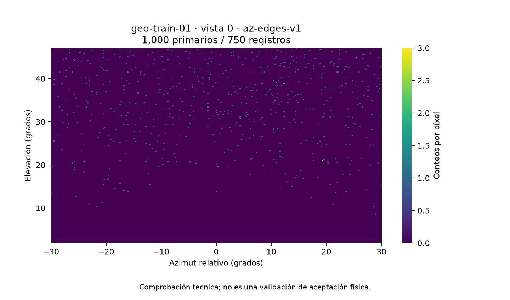

# Cadena local preparada para la malla angular v1

> Avance posterior a la revisión: [fusión y compatibilidad corregidas localmente](CORRECCIONES_LOCALES_FUSION_CONFIGURACION.md), 56 pruebas y contraste con los dos bloques reales. Las observaciones físicas siguen abiertas; adoptar la alternativa en SC3 requiere actualizar las herramientas allí.

> Actualización 2026-10-02: se recibió y revisó la entrega física/producción. Consultar la [revisión vigente](REVISION_FISICA_PRODUCCION_2026-10-02.md) antes de aplicar solicitudes o estados anteriores. La ampliación posterior está documentada en las correcciones locales enlazadas arriba.

Estado al 2026-10-01, Colombia. Se completa una **alternativa local nueva** para recibir, verificar, representar, analizar y empaquetar referencias compatibles. No sustituye los datos históricos, no activa el transporte de listas/ROI en el ejecutable angular y no habilita todavía la campaña final.

## Qué quedó implementado

| Operación | Herramienta | Control relevante |
|---|---|---|
| Revisar la prueba de integración | [revisar_smoke_angular.py](../herramientas/revisar_smoke_angular.py) | 1.000 primarios, malla, conteos, log y código de salida. |
| Leer y exportar una imagen | [preparar_imagen_angular_v1.py](../herramientas/preparar_imagen_angular_v1.py) | Conserva píxeles, coordenadas y huellas de geometría, ejecutable y tablas cuando acompaña el manifiesto de entradas. |
| Dibujar la imagen | [visualizar_angular_v1.py](../herramientas/visualizar_angular_v1.py) | Usa bordes reales; comprueba la imagen antes de dibujar y la ROI antes de superponerla. |
| Calcular regiones geométricas | [preparar_roi_angular_v1.py](../herramientas/preparar_roi_angular_v1.py) | Seis vistas de geo-train-06; geometría auditada, rayos centrales, umbral de 20 m. |
| Contar dentro y fuera de una región | [analizar_roi_angular_v1.py](../herramientas/analizar_roi_angular_v1.py) | Exige igualdad de geometría, vista, posición, malla y huellas. No confunde fracción observada con transmisión física. |
| Auditar y empaquetar referencias | [empaquetar_angular_v1.py](../herramientas/empaquetar_angular_v1.py) | Seis vistas por geometría, configuración compatible y pares reproducibles; bloquea lotes incompletos. |

Las herramientas son alternativas versionadas en nuestra réplica: no se editan los consumidores históricos de los estudiantes. Para adoptar esta cadena no hay que cambiar retrospectivamente sus scripts de etapas 1/2, máscaras congeladas ni análisis A/B.

## Verificación realizada

**41 pruebas locales satisfactorias**, en cinco suites: ocho del revisor, nueve del exportador, ocho del cálculo de regiones, ocho del analizador y ocho del empaquetador. [Registro conjunto](evidencias/pruebas-cadena-local.txt) y [entorno/huellas de validación](evidencias/validacion-cadena-local.json). Incluyen entradas inválidas, mezcla de mallas, corrupciones, vistas faltantes/repetidas, cambios de binario, conteos cero, reproducibilidad de semillas y límites de tipos.

La entrega real de `90abb96` se reexportó con su procedencia, preservando 750 conteos, y se representó con los bordes correctos. Se inspeccionó visualmente la figura; la primera versión tenía una superposición de texto y se corrigió el espacio inferior. La caché de Matplotlib se dirige al área de trabajo de la réplica.



La [auditoría de disponibilidad](evidencias/disponibilidad-campana-angular.json) encuentra **una referencia nueva**, sin errores de formato/procedencia, frente a 114 posiciones del catálogo histórico. Faltan 113 posiciones para completar esa matriz, pero **esto no es una orden de simular 113 vistas**: la referencia presente es una prueba de 1.000 primarios, no una referencia de producción con precisión aprobada. El alcance final y el presupuesto de conteo siguen pendientes de definición física.

Los paquetes completos se probaron con **seis vistas sintéticas de prueba**, que permiten conocer los resultados esperados. No se presentan como nuevas simulaciones del volcán ni se incorporan al catálogo científico.

## Contrato del paquete nuevo

Cada vista produce un NPZ `geo-..._viewN_pairs.npz` con:

- `counts_ref`: referencia uint32 de 256×256.
- `low_counts`: matriz uint32 de 4×20×256×256.
- `fractions`: 0,50; 0,10; 0,05; 0,01.
- Centros y bordes azimutales y de elevación explícitos.

Cada realización se obtiene por reducción binomial de la referencia. Son **80 pares por vista**, 480 por geometría y 9.120 si se completan las 19 geometrías. No son 80 transportes nuevos ni 80 referencias independientes. Las realizaciones comparten la misma referencia. Las fracciones describen reducción de conteos; no certifican días de exposición.

El esquema nuevo de semillas usa semilla maestra, etiqueta de versión, identidad de geometría derivada de SHA-256, vista y fracción; no depende del orden de archivos ni cambia al empaquetar un subconjunto. Se conserva el prefijo train/val/test/gen por geometría, sin redistribuir pares entre particiones. La versión de NumPy queda registrada. Este esquema está identificado como nuevo y no pretende reproducir las realizaciones históricas.

Se utiliza uint32 para los conteos reducidos: **no se recortan silenciosamente a 65.535**. El constructor histórico contiene un recorte uint16; no afirmamos aquí que haya afectado los datos históricos. La prueba nueva incluye referencias de 200.000 conteos para comprobar que se preservan valores superiores al límite uint16.

El manifiesto registra huellas de entradas, paquetes y metadatos; los NPZ se releen y contrastan antes de cerrar el manifiesto. La auditoría exige mismo binario, tablas, motor, definición de muestreo, nota de física, detector, malla y exposición. Cuando la exposición es `-1` (N fijo), exige también igual N entre vistas. Se puede estudiar otra política posteriormente; no se mezcla implícitamente en esta versión.

`technical_complete=true` significa **completitud y coherencia técnica del alcance declarado**, no precisión suficiente ni validación física. Todos los informes conservan `physical_validation=false`. Si se interrumpe una escritura puede quedar un directorio parcial: un paquete sin manifiesto final no es una entrega completa. Las salidas deben ser nuevas, sin sobrescritura.

## Cómo usar la cadena

Dependencias efectivamente probadas: Python 3.12.14, NumPy 2.4.4 y Matplotlib 3.11.1. [Versiones fijadas](../requirements-oe1-local.txt). No se probó una instalación desde cero en otro sistema ni se requiere Geant4 para estas herramientas.

Desde la raíz de la réplica, con entradas reales y carpetas nuevas:

```console
python herramientas/revisar_smoke_angular.py ENTREGA/corrida --salida NUEVA_REVISION.json
python herramientas/preparar_imagen_angular_v1.py ENTREGA/corrida/geo-train-01_view0_hist.csv --salida IMAGENES_NUEVAS
python herramientas/visualizar_angular_v1.py IMAGENES_NUEVAS/geo-train-01_view0.npz --salida NUEVA_FIGURA.png
python herramientas/empaquetar_angular_v1.py IMAGENES_NUEVAS --informe NUEVO_INVENTARIO.json
python -m unittest discover -s herramientas -p "test_*angular*.py" -v
```

La auditoría devuelve código 1 si faltan vistas o hay incompatibilidades, y escribe el detalle. **Ese es el resultado esperado para la entrega actual de una sola vista.** Sin `--geometrias` revisa las 19 del catálogo. Para un alcance parcial explícito se pueden indicar IDs; aun así exige las seis vistas de cada geometría antes de empaquetar:

```console
python herramientas/empaquetar_angular_v1.py IMAGENES_NUEVAS --geometrias geo-train-01 --informe NUEVA_REVISION_LOTE.json --salida PAQUETE_NUEVO
```

Este último comando queda preparado para cuando existan seis referencias compatibles; no procede con la entrega actual. No añadir copias ni cambiar nombres para completar los huecos. Las geometrías y metadatos de imágenes deben conservar la procedencia de la ejecución original. Las huellas declaradas no reemplazan la revisión del código, compilación y ejecución que produjo los archivos.

## Límite del trabajo local y siguiente entrega necesaria

Se amplió la búsqueda del respaldo de producción a la historia disponible del repositorio fuente (no superficial), referencias locales actualizadas y commit `0dea8e1`. No aparecen los cinco documentos/scripts históricos buscados ni un paquete específico de convergencia: [alcance exacto de búsqueda](evidencias/busqueda-respaldo-produccion.json). Solo se identifica el JSON de comparación entre motores entre los nombres relacionados. Puede haber evidencia adicional en SC3 o en otros archivos no incorporados; no damos por inexistente ese material.

Para avanzar físicamente necesitamos una entrega acotada de los estudiantes:

1. Los resultados y comandos de la comparación de planos de 100, 300 y 600 m, y cualquier tamaño adicional utilizado para estimar la asíntota; incluir semillas y conteos, no solo porcentajes.
2. La explicación de qué representa la imagen: llegadas a un detector de 1,2 m o un estimador direccional idealizado; cómo se justifica la compensación por dispersión y la relación con el tiempo de exposición. Aclarar también la superficie y convención energética de la tasa heredada del surrogate: [diagnóstico de fuente](REVISION_ACEPTACION_PLANO.md#precisión-adicional-sobre-la-normalización-de-la-fuente).
3. La receta completa del entorno y ejecución: código, compilación, bibliotecas/datos físicos Geant4 y opciones. Geant4 11.4.2 está respaldado para los ensayos, pero no debe inferirse equivalencia con el Docker histórico 11.3.2.

Con esa evidencia se podrá decidir si basta la justificación existente o diseñar **un control físico dirigido** con referencia y criterio definidos de antemano. No se lanza otra campaña por el solo hecho de tener herramientas listas. No tenemos acceso a la sesión SC3 para recuperar lo que solo esté allí.

El plan provisional de 36 vistas a regenerar y 78 a reutilizar estaba condicionado a conservar la definición de los datos. **Con la malla nueva no se pueden reutilizar matrices antiguas cambiando sus etiquetas.** La decisión final debe tratar explícitamente esa compatibilidad, el observable y la precisión de referencia; aún no se fija N de producción ni presupuesto SC3.

### Mensaje preparado, no enviado

Daniel y Reinaldo, la prueba de la corrección angular quedó revisada satisfactoriamente. Ya dejamos preparadas las herramientas para verificar, representar y organizar las imágenes y generar sus versiones de menor conteo. Por ahora no necesitamos repetir esa prueba ni lanzar la campaña grande. Para cerrar la justificación física, necesitamos que compartan los archivos y comandos con los que compararon los planos de 100, 300 y 600 metros, y nos expliquen cómo relacionan ese conteo con el detector pequeño y el tiempo de exposición. Si usaron otros tamaños para estimar la convergencia, inclúyanlos. Con esa información revisaremos qué falta y fijaremos el alcance de la campaña final.
