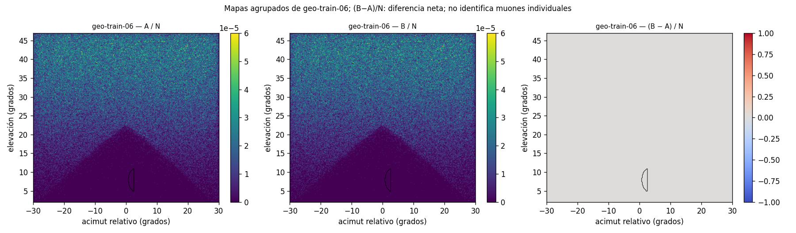
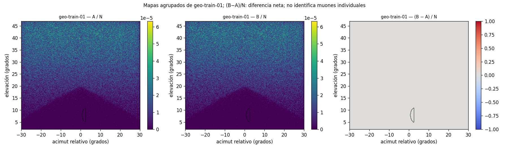

# Resultados de la etapa 1 del segundo ensayo OE1

Las 13 corridas de la etapa 1 terminaron en SC3 (trabajo 30569, 13 de 13 OK) y los contratos del análisis dieron OK en sus 405 comprobaciones.
En los 600.000 primarios emparejados ninguno cambió de resultado entre A y B: n01 = n10 = 0 en geo-train-06 y en geo-train-01, y cada muón detectado cayó en el mismo bin con las dos geometrías.
Solo un muón de producción cruzó la región Z (geo-train-06, réplica 2, id 3910); tuvo el mismo registro en A y en B y entró por el lado del elipsoide.
Estos resultados muestran que la instrumentación y el emparejamiento funcionan.
No acotan el efecto de la corrección: el semiancho del intervalo diagnóstico de Tango (12,8 por millón) es unas 47 veces el margen M1 propuesto en la sección 6, y ninguna conclusión de una vista certifica las 114 vistas (PROT:82).

Las secciones 1 a 6 cubren los ítems 1 a 6 de la sección 7 del [protocolo v1.0](../../PROTOCOLO_SEGUNDO_ENSAYO_OE1.md); PROT:n es la línea n de ese archivo. Las horas están en UTC.

## 0. Identificación

| Dato | Valor |
|---|---|
| Fecha | 30 de septiembre de 2026 (Colombia, UTC−5); las horas de `sacct` se pasan a UTC |
| Casos y finalidad | geo-train-06, vista 0 (afectado), y geo-train-01, vista 0 (control angular). Comprobar la instrumentación y recoger un diagnóstico emparejado primario a primario (PROT §4) |
| Observable | Δ = promedio(Y_B − Y_A), con Y = 1 si el muón se detecta dentro de R_int, la máscara angular de 195 píxeles de la entrega `712c786` (PROT:59-63) |
| Región Z | Intersección del cilindro (anomalía 0) y el elipsoide (anomalía 1) de geo-train-06, con las primitivas originales del JSON |
| Repositorio de la entrega | `muografia-documentada`, rama `oe1/segundo-ensayo-etapa-1`: protocolo `1054fb8`; decisiones `c12f758` (19:28:38); congelamiento `220c78c` (20:27:09, 24 s antes del inicio del trabajo 30569) |
| Código | `muography-dl-reconstruction`, rama `oe1/stage1-instrumentation`: A `9520170`, B `f1edc80`, A2 `fdaef4b`, B2 `9bb43f3`, análisis `59e03c8`, herramientas `3315f82` ([`codigo/commits.txt`](codigo/commits.txt) y [`codigo/invariantes.txt`](codigo/invariantes.txt)) |
| Trabajos SLURM | Partición `legacy`. En guane01: 30563 compilación, 30564 K0 intento 1 (FAILED, sección 5) y 30565 K0 intento 2. En guane02: 30567 preparación, 30568 pruebas técnicas, 30569 producción y 30570 análisis ([`entorno/sacct-trabajos-etapa1.txt`](entorno/sacct-trabajos-etapa1.txt)) |
| Producción | Trabajo 30569 en guane02, de 20:27:33 a 20:29:10 (1 min 37 s), COMPLETED; 13 de 13 corridas OK ([`corridas/intento-01/OK.txt`](corridas/intento-01/OK.txt)) |

## 1. Implementación, comandos y entorno

Las decisiones de implementación están en [`DECISIONES_IMPLEMENTACION.md`](DECISIONES_IMPLEMENTACION.md), registrado en `c12f758` (19:28:38), antes de cualquier transporte en SC3, y ajustado en `220c78c` (20:27:09) solo en rutas de archivos, patrones de `.gitattributes` (DV6) y en la forma de conservar la evidencia técnica. B aplica la regla «la última anomalía del JSON prevalece» sin cambiar densidades, posiciones ni catálogo. El diff entre A2 y B2 es igual al diff entre A y B y solo toca `src/DetectorConstruction.cc` ([`codigo/invariantes.txt`](codigo/invariantes.txt), I1 e I2).

- Física: Geant4 11.4.2 con FTFP_BERT; cortes, secundarios, generador, tablas y detector del piloto, sin cambios (`DECISIONES_IMPLEMENTACION.md`, sección 2).
- Compilación: g++ 14.2.0, CMake 3.31.8, Release `-O3 -DNDEBUG`, 0 avisos. Binarios A2 `a07d83c4…` y B2 `ae761866…` (`entorno/compilacion.txt`, `entorno/binarios.sha256`).
- Ejecución: `G4TaskRunManager` con un hilo trabajador y 13 procesos simultáneos en guane02 (2 Intel Xeon E5645 a 2,40 GHz, 24 CPU lógicas). Se pidieron 13 CPU, 8 GB y 30 min; `sacct` informa 14 CPU asignadas (`corridas/intento-01/entorno.txt`, `principal.sbatch.copia`).
- Comandos: `comando.txt` en la carpeta de cada corrida, y `analisis/etapa1-01/comando-analisis.txt` para el análisis.

La tabla resume las desviaciones y definiciones operativas respecto al protocolo; D-Q1 a D-Q7 (sección 1 de `DECISIONES_IMPLEMENTACION.md`) se aplicaron como están escritas.

| ID | Contenido | Estado | Evidencia |
|---|---|---|---|
| DV1 | Pruebas técnicas fuera de las 13 corridas: 24.120 transportes | aplicada | trabajo 30568; `pruebas/resumen-pruebas-tecnicas.json` |
| DV2 | Resiembra por muón con {`id`, `s_tr`, `case_code`, `TAG_TR`}; `s_tr = s_src − 10⁹` | aplicada | K0 (manifiesto), K9 (a), T-M y T-P |
| DV3 | `in_rint` escrito por el binario y recalculado fuera de línea | aplicada | K6.16: 0 diferencias en las 13 corridas |
| DV4 | Campos de cruce «no aplica» en geo-train-01 | aplicada | K6.21: `crossed = −1` en sus 7 corridas |
| DV5 | Listas y registros por muón en almacenamiento compartido | aplicada | carpeta compartida del proyecto ([`datos-compartidos/ENLACE.txt`](datos-compartidos/ENLACE.txt), sección «Datos pesados») |
| DV6 | `.gitattributes` solo para extensiones de datos | aplicada | [`.gitattributes`](.gitattributes); no cubre `*.copia` ni `*.status`, que tienen 0 bytes CR |
| DV7 | Tabla por corrida ampliada y transiciones por par | aplicada | `analisis/etapa1-01/tabla-corridas.csv` y `transiciones.csv` |
| DV8 | Cruce con ε = 1 µm y roces aparte; longitud, material y energía | aplicada | C1 a C9, R1, V y T-S (sección 3) |
| DV9 | Discordancias clasificadas; solo bloquean la atribución al solape | aplicada | K9 (b): 0 discordancias; `atribucion_al_solape_bloqueada = false` |

## 2. Muones iniciales y correspondencia A/B

Hay seis listas congeladas, una por caso y réplica, de 100.000 muones cada una. Se generaron antes del transporte con el muestreador del piloto sin cambios: 7 números uniformes por muón, con un motor MixMax privado y la clave {`s_src`, `case_code`, 0, `TAG_SRC`}. Columnas `id,x_m,y_m,z_m,dx,dy,dz,ekin_gev,pdg,charge_e`: posición en m en el marco del mundo, dirección unitaria, energía cinética en GeV y PDG ±13. La fila `id` es el evento `id` en A y en B. Semillas de fuente 2026092901 a 2026092903 en los dos casos; de transporte, `s_tr = s_src − 10⁹`. Huellas en [`primarios/listas-prep-01.sha256`](primarios/listas-prep-01.sha256) y validación en [`primarios/validacion-listas.txt`](primarios/validacion-listas.txt).

| Lista | SHA-256 (inicio) | FNV canónica | Menor p del validador |
|---|---|---|---|
| geo-train-06, r1 | `a676dd129a2b…` | `17b2c3a5d5221296` | 0,021 |
| geo-train-06, r2 | `b3637415b4e5…` | `b266bbd227ee2d1a` | 0,0303 |
| geo-train-06, r3 | `77a62b535a52…` | `81051b5efda04332` | 0,0201 |
| geo-train-01, r1 | `bfdbaf9bd5bd…` | `5408480e1aa8038f` | 0,0188 |
| geo-train-01, r2 | `0d78a88443cd…` | `7d9b7bdc7439eb6a` | 0,0264 |
| geo-train-01, r3 | `f63209cafec6…` | `f37169c5944fbbfb` | 0,012 |

- K1, antes del transporte. A2 y B2 escribieron las seis listas en carpetas distintas: los doce archivos dan seis SHA-256, iguales en A2 y en B2, y los `.meta.json` solo difieren en el SHA-256 del binario. En las seis, `id` va de 0 a 99.999 sin huecos ni duplicados, no hay estados iniciales repetidos, |d| = 1 ± 10⁻¹², dz < 0, Ekin > 0 y el PDG concuerda con la carga. Las seis FNV son distintas y el menor valor p de las pruebas del modelo de fuente es 0,012 (umbral 10⁻⁴).
- Durante el transporte. `prim_fnv` recalculado desde la lista coincide para todo id en las 13 corridas (K6.9). `prim_fnv` y `rng0` son iguales en A y en B para todo id de los seis pares (K9 (a)).
- Repetición A/A (K7). g01-A-r1-rep repite g01-A-r1 con la misma lista y la misma `s_tr`, en el mismo trabajo y nodo. `_muones.csv` y `hist.csv` son idénticos byte a byte (SHA-256 `2e6a6802…` y `e81868c2…`), y `meta.json` solo difiere en cinco claves de tiempo y recursos. La repetición no entra en Δ, en las transiciones, en el agrupado ni en la DE.

## 3. Controles y pruebas

Los contratos del análisis en SC3 dieron OK en sus 405 comprobaciones (K0 16, K6 351, K7 5, K8 9 y K9 24), sin fallos bloqueantes ni no bloqueantes ([`analisis/etapa1-01/contratos.json`](analisis/etapa1-01/contratos.json)).

| Control | Resultado | Evidencia |
|---|---|---|
| K0 | Antes del transporte, OK en el intento 2: 7 de 7 bloques con rc = 0 y 13 de 13 resultados PASS del detector de cruces. En el análisis, manifiesto de 13 corridas, `s_tr = s_src − 10⁹`, listas y máscara con sus SHA-256 | `pruebas/k0/resumen.txt`, `pruebas/k0/cruces/pruebas-cruces.json`, `contratos.json` |
| K2: `--check-geometry` con resolución 100.000, tolerancia 0, `maxErr` 100 y semilla 20260929 | B2: `status=OK`, 0 solapes y 0 G4Exception en los dos casos; en geo-train-06, dos líneas `ANOMALY-CSG` con `clipped=no`. A2: OK en geo-train-01; en geo-train-06 conserva el solape histórico (2 solapes; 3 avisos G4Exception GeomVol1002, en 9 líneas del registro) | `control-geometrico/resumen-K2.tsv` |
| K-ROI | Centroide de Z en el píxel (34, 135), dentro de R_int; su espejo en acimut, (34, 120), fuera. Masa de L_Z: 0,9694 en R_int y 0 en el espejo; Jaccard 0,9949 | `pruebas/kroi.txt` |
| K6 en cada corrida | Filas = N, `id` de 0 a N − 1 sin repetir, sin ABORTED, histograma rehecho con las filas DET igual a `hist.csv` en las 65.536 celdas, `in_rint` igual al recálculo, B sin avisos | `contratos.json` |
| K8: control, A frente a B | `hist.csv` idéntico y `_muones.csv` igual salvo `variant` en los tres pares | `contratos.json` |
| K9: A frente a B | (a) `prim_fnv` y `rng0` iguales; (b) 0 discordancias; (c) en B, `lz_a0` y `lz_rock` valen 0 m | `contratos.json` |
| Pruebas técnicas (DV1) | T-L (A y B), T-R, T-M, T-P, T-S (A2 y B2) y T-F: 8 de 8 OK | `pruebas/resumen-pruebas-tecnicas.json` |

Las respuestas a las dos preguntas sobre las pruebas técnicas están en [`pruebas/RESULTADOS_PRUEBAS_TECNICAS.md`](pruebas/RESULTADOS_PRUEBAS_TECNICAS.md). El registro por muón no altera la simulación (T-R, T-L, T-M y T-P). La detección de cruces funciona como se espera: `test_region_crossing` (C1 a C9 y V) pasa 453.607 comprobaciones sin fallos, R1 pasa con seis semillas y T-S clasifica bien 60 de 60 muones en A2 y en B2.

En producción, `crossed` coincide con la recta inicial en todos los muones de geo-train-06 con al menos 1.000 GeV (297, 282 y 296 por réplica). Ninguna de esas rectas corta Z, así que la comparación solo cubre casos sin cruce ([`resultados-etapa1.json`](analisis/etapa1-01/resultados-etapa1.json), `verificacion_de_la_recta`).

## 4. Resultados por corrida y por par

Fuente: análisis del trabajo 30570 en SC3, [`analisis/etapa1-01/`](analisis/etapa1-01/). La reproducción local ([`analisis/reproduccion-local-01/`](analisis/reproduccion-local-01/)) da las seis tablas CSV idénticas byte a byte y los seis arreglos de `mapas-etapa1.npz` iguales; solo cambian 2 fechas, 11 rutas y 7 campos de entorno, y además genera las dos figuras ([`analisis/comparacion-sc3-local.txt`](analisis/comparacion-sc3-local.txt)).

### 4.1 Tabla por corrida (DV7)

| Corrida | `s_src` | N | Detectados | ΣY en R_int | Cruces de Z | Avisos | Pared (s) | CPU (s) | RSS (kB) |
|---|---|---|---|---|---|---|---|---|---|
| [g06-A-r1](corridas/intento-01/geo-train-06/A/2026092901/) | 2026092901 | 100.000 | 75.158 | 0 | 0 | GeomVol1002=1 | 87,1 | 90,0 | 115.940 |
| [g06-B-r1](corridas/intento-01/geo-train-06/B/2026092901/) | 2026092901 | 100.000 | 75.158 | 0 | 0 | ninguno | 79,0 | 81,6 | 116.576 |
| [g06-A-r2](corridas/intento-01/geo-train-06/A/2026092902/) | 2026092902 | 100.000 | 75.319 | 1 | 1 | GeomVol1002=1 | 86,2 | 88,9 | 118.156 |
| [g06-B-r2](corridas/intento-01/geo-train-06/B/2026092902/) | 2026092902 | 100.000 | 75.319 | 1 | 1 | ninguno | 84,6 | 87,1 | 115.392 |
| [g06-A-r3](corridas/intento-01/geo-train-06/A/2026092903/) | 2026092903 | 100.000 | 75.190 | 0 | 0 | GeomVol1002=1 | 87,1 | 89,9 | 116.668 |
| [g06-B-r3](corridas/intento-01/geo-train-06/B/2026092903/) | 2026092903 | 100.000 | 75.190 | 0 | 0 | ninguno | 76,7 | 79,5 | 116.700 |
| [g01-A-r1](corridas/intento-01/geo-train-01/A/2026092901/) | 2026092901 | 100.000 | 73.625 | 1 | no aplica | ninguno | 86,8 | 89,3 | 115.004 |
| [g01-B-r1](corridas/intento-01/geo-train-01/B/2026092901/) | 2026092901 | 100.000 | 73.625 | 1 | no aplica | ninguno | 86,8 | 89,5 | 115.716 |
| [g01-A-r2](corridas/intento-01/geo-train-01/A/2026092902/) | 2026092902 | 100.000 | 73.844 | 0 | no aplica | ninguno | 86,6 | 89,2 | 115.952 |
| [g01-B-r2](corridas/intento-01/geo-train-01/B/2026092902/) | 2026092902 | 100.000 | 73.844 | 0 | no aplica | ninguno | 81,4 | 84,0 | 116.032 |
| [g01-A-r3](corridas/intento-01/geo-train-01/A/2026092903/) | 2026092903 | 100.000 | 73.776 | 0 | no aplica | ninguno | 78,6 | 81,4 | 116.364 |
| [g01-B-r3](corridas/intento-01/geo-train-01/B/2026092903/) | 2026092903 | 100.000 | 73.776 | 0 | no aplica | ninguno | 55,8 | 58,5 | 115.620 |
| [g01-A-r1-rep](corridas/intento-01/geo-train-01/A-repeticion/2026092901/) | 2026092901 | 100.000 | 73.625 | 1 | no aplica | ninguno | 88,6 | 91,3 | 116.060 |

Fuente: [`analisis/etapa1-01/tabla-corridas.csv`](analisis/etapa1-01/tabla-corridas.csv), que trae también los estados finales. Las 13 corridas son del trabajo 30569 en guane02; empezaron a las 20:27:36 y terminaron entre las 20:28:36 y las 20:29:10 ([`corridas/intento-01/estado.tsv`](corridas/intento-01/estado.tsv)). `s_tr = s_src − 10⁹`. ΣY cuenta los muones detectados dentro de R_int; en geo-train-01 los cruces no aplican (DV4). CPU y RSS salen de `getrusage` del propio proceso, que el binario escribe en `meta.json`. El aviso de A en geo-train-06 es el que espera el manifiesto (`avisos.txt`: `coinciden=si`). La eficiencia va de 0,73625 a 0,75319 y queda a |z| ≤ 1,23 de la de la campaña (K6.15). Los estados finales son iguales en A y en B de cada par, y STOPPED, OTHER y ABORTED valen 0 en las 13 corridas.

### 4.2 Transiciones por par y Δ agrupado

n_ab cuenta los muones con (Y_A, Y_B) = (a, b); Δ = (n01 − n10)/N, y 10⁶·Δ está en cuentas por millón de primarios generados, con denominador N ([`analisis/etapa1-01/transiciones.csv`](analisis/etapa1-01/transiciones.csv)). En geo-train-01, R_int actúa como máscara angular de control, porque allí no hay intersección (PROT:59).

| Caso | Ámbito | N | n00 | n01 | n10 | n11 | 10⁶·Δ | Tango 95 %, por millón |
|---|---|---|---|---|---|---|---|---|
| geo-train-06 | réplica 1 | 100.000 | 100.000 | 0 | 0 | 0 | 0 | [−38,413; 38,413] |
| geo-train-06 | réplica 2 | 100.000 | 99.999 | 0 | 0 | 1 | 0 | [−38,413; 38,413] |
| geo-train-06 | réplica 3 | 100.000 | 100.000 | 0 | 0 | 0 | 0 | [−38,413; 38,413] |
| geo-train-06 | agrupado | 300.000 | 299.999 | 0 | 0 | 1 | 0 | [−12,805; 12,805] |
| geo-train-01 | réplica 1 | 100.000 | 99.999 | 0 | 0 | 1 | 0 | [−38,413; 38,413] |
| geo-train-01 | réplica 2 | 100.000 | 100.000 | 0 | 0 | 0 | 0 | [−38,413; 38,413] |
| geo-train-01 | réplica 3 | 100.000 | 100.000 | 0 | 0 | 0 | 0 | [−38,413; 38,413] |
| geo-train-01 | agrupado | 300.000 | 299.999 | 0 | 0 | 1 | 0 | [−12,805; 12,805] |

- El intervalo de Tango es un diagnóstico que no acota el efecto: la etapa 1 no está dimensionada y el intervalo no decide equivalencia (`intervalo_no_acota_el_efecto = true`). McNemar exacto no informa, porque b = n01 + n10 = 0.
- Por réplica, Δ vale 0, 0 y 0 en cada caso: media 0, DE (desviación estándar) 0 y rango [0; 0]. DE = 0 entre réplicas no implica incertidumbre cero (PROT:76).
- Clopper-Pearson al 95 %, bilateral, para p_A y p_B con ΣY = 1 en N = 300.000: [0,084; 18,57] por millón en los dos casos. Dato: ΣY y N. Supuesto sin comprobar: primarios independientes con una sola probabilidad.

### 4.3 Detección y cambios de bin

- Ningún muón se detectó en una sola variante (m01 = m10 = 0 en los seis pares). Los 225.667 detectados de geo-train-06 y los 221.245 de geo-train-01 cayeron en el mismo bin con A y con B ([`cambios-bin.csv`](analisis/etapa1-01/cambios-bin.csv)), y la matriz 7 × 7 de clases es diagonal ([`matriz-clases.csv`](analisis/etapa1-01/matriz-clases.csv)).
- En cada par, los `hist.csv` de A y de B tienen el mismo SHA-256 ([`SHA256SUMS-crudos.txt`](corridas/intento-01/SHA256SUMS-crudos.txt)).
- En geo-train-01, K8 comprueba que los registros por muón de A y de B solo difieren en la columna `variant`. En geo-train-06, K9 (b) no halla diferencias en `detected`, `status`, `iel`, `iaz`, `in_rint` ni `rng1` en los 300.000 pares.

### 4.4 Cruces de la región Z

Un solo muón cruzó Z en las 13 corridas de producción: geo-train-06, réplica 2, id 3910 (los muones sintéticos de T-S atraviesan Z por diseño y no cuentan). Cruzó en A y en B con el mismo registro ([`cruces-union.csv`](analisis/etapa1-01/cruces-union.csv); pasos y entradas en el `meta.json` de la corrida). La selección común U (cruza en A o en B) tiene |U| = 1 y Δ_U = 0 con denominador 1; este análisis condicional no sustituye a Δ (PROT:69).

| Magnitud | Valor, igual en A y en B |
|---|---|
| Energía cinética inicial, al entrar en Z y al salir | 221,73 GeV; 36,87 GeV; 19,30 GeV |
| Longitud en Z, de cuerda y verdadera | 25,62387 m y 25,62393 m, toda en A1 (`mat_in = mat_out = A1`, `lz_a0 = lz_rock = 0`) |
| Pasos en Z, entradas y escala del error (`sum_lat_z_mm`) | 18 pasos, 1 entrada, 1,6 × 10⁻¹⁰ mm |
| Final | MU_CAPTURE (`muMinusCaptureAtRest`) en `anomaly_1`; no detectado |

### 4.5 Mapas

Figura 1. geo-train-06, tres réplicas agrupadas: A/N, B/N y (B − A)/N, con el contorno de R_int. (B − A)/N: diferencia neta; no identifica muones individuales. Fuente: [`figuras/mapa-geo-train-06.png`](analisis/reproduccion-local-01/figuras/mapa-geo-train-06.png), generada por `oe1_stage1_analysis.py` en la reproducción local; sus arreglos son iguales a los de `analisis/etapa1-01/mapas-etapa1.npz`.

Figura 2. geo-train-01 (control angular), con los mismos paneles. (B − A)/N: diferencia neta; no identifica muones individuales. Fuente: [`figuras/mapa-geo-train-01.png`](analisis/reproduccion-local-01/figuras/mapa-geo-train-01.png), con el mismo origen que la figura 1.

### 4.6 Registros y manifiestos

- Cada corrida tiene su carpeta `corridas/intento-01/<caso>/<A|B|A-repeticion>/<s_src>/` con `comando.txt`, `entradas.sha256`, `run.log`, `avisos.txt`, `recursos.json`, `meta.json`, `hist.csv` y `SHA256SUMS`.
- Los `_muones.csv` no están en esta carpeta (DV5). Sus SHA-256 están en el `SHA256SUMS` de cada corrida y en [`SHA256SUMS-crudos.txt`](corridas/intento-01/SHA256SUMS-crudos.txt); los de los comprimidos, en [`SHA256SUMS-gz.txt`](corridas/intento-01/SHA256SUMS-gz.txt). `sha256sum -c --ignore-missing` comprueba los archivos presentes.
- Manifiesto de las 13 corridas: [`corridas/intento-01/manifiesto-corridas.tsv`](corridas/intento-01/manifiesto-corridas.tsv), con el mismo SHA-256 (`0a9acf64…`) que la copia congelada en `220c78c` ([`analisis/congelamiento/`](analisis/congelamiento/)). SHA-256 del tar del intento: [`corridas/intento-01.tar.sha256`](corridas/intento-01.tar.sha256).

## 5. Fallos, reintentos y limitaciones

Fallos y reintentos:
- K0, intento 1 (trabajo 30564, FAILED 1:0). Las pruebas de C++ se compilaron con la disposición de carpetas del paquete del piloto y no encontraron `json.hpp`; las de Python no encontraron las tablas (106 ejecutadas, 24 errores). El intento 2 (trabajo 30565) repitió las mismas pruebas con la disposición del repositorio y el mismo código bajo prueba ([`pruebas/k0-intento-1/MOTIVO.md`](pruebas/k0-intento-1/MOTIVO.md)).
- Producción: un solo intento, `intento-01`, con 13 de 13 corridas OK y sin reintentos. La etapa sumó 1.300.000 transportes de producción y 24.120 de pruebas técnicas (DV1).
- `pruebas/analisis-TF/mapas-etapa1.npz` tiene hora de modificación 20:00:24, 1 min 42 s después del resto de esa carpeta (19:58:42). Es compatible con una escritura diferida del sistema de archivos compartido. Al repetir ese análisis, los seis arreglos y todas las tablas coinciden; en `contratos.json` solo cambian la fecha y la forma de las rutas ([`pruebas/RESULTADOS_PRUEBAS_TECNICAS.md`](pruebas/RESULTADOS_PRUEBAS_TECNICAS.md)).

Limitaciones:
- La etapa 1 no está dimensionada para detectar un efecto físico pequeño (PROT:44). Con ΣY = 1 por caso en 300.000 primarios, lo esperable era n01 = n10 = 0; D-Q4 preveía unas 0,27 detecciones en R_int por corrida. PROT:44 no cuenta un resultado nulo como fallo si los contratos se cumplen, y aquí se cumplen.
- El único cruce entró en Z desde el elipsoide (`mat_in = A1`). En A, el material dentro de Z depende del lado de entrada (`DECISIONES_IMPLEMENTACION.md`, sección 5.2). La entrada desde el conducto, donde A y B navegan distinto, no tuvo ningún muón en esta etapa.
- En transporte real, la detección de cruces descansa en T-S (60 muones sintéticos de 10 TeV) y en ese único cruce.
- Las longitudes en Z son de cuerda. `max_lat_mm` supera 10⁻⁶ mm en el 88,8 % a 89,9 % de los muones de cada corrida; `max_lat_z_mm` vale 0 en las réplicas 1 y 3 de geo-train-06 y 0,077 mm en la réplica 2. Es una escala del error y no lo acota.
- Los transportes de desarrollo fuera de SC3 (WSL, con Geant4 11.4.2 compilado allí) sirvieron para depurar y no son evidencia. Ninguna cifra de este documento sale de ellos.

## 6. Propuesta para la etapa 2

Esta sección solo propone: margen, método, tamaño y recursos se fijan por escrito en la versión 1.1 del protocolo, antes de nuevas corridas (PROT:73, PROT:80). Como pide O-03, cada insumo se rotula como dato (medido o registrado en un archivo) o supuesto (elegido y sin comprobar). Las estimaciones son por caso, con A y B.

| Elemento | Propuesta | Datos | Supuestos |
|---|---|---|---|
| Margen | M1 = k·√λ₃₀/N₃₀ = √98/36.174.382 ≈ 2,74 × 10⁻⁷ por primario (0,274 por millón), el ruido de Poisson de R_int en una imagen de 30 días. M2, una fracción ε de la señal de la anomalía en R_int, solo entra con ε justificado; aquí no se fija ε. Ningún margen sale del resultado más favorable del piloto (PROT:75) | λ₃₀ = 98 cuentas en R_int y N₃₀ = 36.174.382 primarios de la imagen de campaña de 30 días de geo-train-06, vista 0 (`DECISIONES_IMPLEMENTACION.md`, secciones 1 y 9) | conteo de Poisson; k = 1 |
| Incertidumbre | Análisis pareado por muón, unido por `id`. Intervalo score de Tango (definido también con b = 0) o de Newcombe; TOST con el margen si se busca equivalencia, que se declara solo si el intervalo cae entero dentro de [−M; M] (PROT:82). Las réplicas o bloques sirven para ver heterogeneidad; su DE no es la incertidumbre (PROT:76) | n00, n01, n10 y n11 por par (`transiciones.csv`) | pares A/B independientes entre sí, con las mismas probabilidades de transición (sin comprobar) |
| Tamaño | Con b = 0 el intervalo es ±z²/(N + z²) y su semiancho baja como 1/N. Factor: 12,805/0,274 ≈ 47 (46,8 sin redondear), así que N ≈ 47 × 300.000 ≈ 1,4 × 10⁷ primarios por caso, cada uno en A y en B. Con TOST al 5 % (intervalo del 90 %, z = 1,645) el factor baja a unas 33 veces | semiancho de 12,805 por millón con N = 300.000 (`transiciones.csv`) | b = 0 también en la etapa 2 (con discordancias, N crece); 95 % bilateral, z = 1,96; M1 con k = 1 |
| CPU | 2,8 × 10⁷ transportes × 84,6 s/10⁵ ≈ 23.700 s ≈ 6,6 h por caso (4,5 a 7,1 h con el mínimo y el máximo medidos) | 84,6 s por 100.000 muones, media de las 13 corridas, de 58,5 a 91,3 s (`tabla-corridas.csv`) | mismo tipo de nodo y mismo coste por muón |
| Tiempo y memoria | ≈ 30 min de pared por caso más la espera en cola; ≈ 116 MB por proceso | 13 procesos simultáneos en el trabajo 30569; RSS de 115.004 a 118.156 kB por proceso | 13 procesos de un hilo por nodo |
| Disco | Registro completo ≈ 9,2 GB por caso; con `gzip -9`, ≈ 2,8 GB; listas de primarios, ≈ 2,0 GB | 326,87 B por muón (424.932.502 B en 1.300.000, `meta.json`); 101,7 B con `gzip -9` (13 `_muones.csv.gz` del tar); listas, 145,6 B por muón (87.369.045 B en 600.000); 596 MB libres en `/home` | mismo formato de registro y de lista |

- Ni el registro completo ni el comprimido caben en los 596 MB libres de `/home` ([`entorno/cuota-home-sc3.txt`](entorno/cuota-home-sc3.txt)). `principal.sbatch` exige 800 MB libres, así que con ese espacio tampoco arrancaría un intento como el de la etapa 1. Se propone un registro reducido: fila completa solo para los muones que cruzan Z, los discordantes y los detectados en R_int, y para el resto sus huellas (`prim_fnv`, `rng0`, `rng1`) con el resultado. Su tamaño se mide en una prueba técnica. La alternativa es disponer de más almacenamiento.
- `muography_sim.cc` llama `runManager->BeamOn(static_cast<G4int>(events))` (contexto de [`codigo/P2-instrumentacion.diff`](codigo/P2-instrumentacion.diff)), y el id de evento de Geant4 también es `G4int`: una ejecución admite a lo sumo 2³¹ − 1 = 2.147.483.647 eventos. N por caso queda por debajo, pero se propone partir cada caso en bloques con un id global de 64 bits (bloque, id local), para repartirlos entre nodos y repetir un bloque sin rehacer los demás.
- El tamaño se fija antes de correr, con réplicas o bloques nuevos e independientes, y con semillas de fuente y de transporte distintas de todas las de la etapa 1 (`DECISIONES_IMPLEMENTACION.md`, secciones 3.3 y 4). Las réplicas de la etapa 2 son nuevas e independientes y los datos de desarrollo quedan aparte (PROT:77); se propone además no agrupar los datos de la etapa 1 con los de la etapa 2. Si se usa multihilo, el contrato de correspondencia se verifica de nuevo (PROT:26).

## 7. Observaciones O-01 a O-05 de [`REVISION_ENTREGA_2026-09-29.md`](../../REVISION_ENTREGA_2026-09-29.md)

| Obs. | Tratamiento en esta entrega | Regla de redacción |
|---|---|---|
| O-01 | La geometría (K2, avisos) va aparte del transporte (Δ, transiciones). La etapa 1 es diagnóstica. | No se deduce ausencia de cambio físico de la falta de avisos, de conteos globales iguales ni de cero discordancias (PROT:44). |
| O-02 | Los cambios individuales salen solo de registros pareados con correspondencia verificada (K1, K9 (a)). Las diferencias de histograma se llaman «diferencia neta». | El resultado de la tercera semilla del piloto es una «diferencia neta de dos celdas» y no identifica un evento. |
| O-03 | No se usan 1/3.000.000, r̂ ni Δ_max como tasas. Cada insumo de la sección 6 lleva «dato» o «supuesto». | «Tasa medida» solo para lo medido. |
| O-04 | B sigue la regla «la última anomalía del JSON prevalece», coherente con el motor analítico. K2 da `clipped=no` en B2, así que el margen de recorte de 1 mm no interviene en geo-train-06. Los casos que combinan recorte y varias sustracciones siguen sin ensayar. | Nunca «identidad geométrica exacta». |
| O-05 | geo-train-01 es el control (K8) y aloja la repetición A/A (K7). El entorno se registra por trabajo (secciones 0 y 1). | P-01 a P-04 no cambian con esta entrega. |

## 8. Conclusión acotada

- La instrumentación y el emparejamiento se sostienen: las listas son idénticas en A2 y B2, `prim_fnv` y `rng0` coinciden para todo id, la repetición A/A es idéntica byte a byte y las 405 comprobaciones del análisis dan OK.
- En la etapa 1, ningún muón cambió de resultado entre A y B en ninguno de los dos casos: n01 = n10 = 0, ningún cambio de bin y ninguna discordancia en 600.000 pares.
- Esto no acota el efecto de la corrección. El semiancho del intervalo de Tango (12,8 por millón) es unas 47 veces M1, y la entrada a Z por el conducto no tuvo ningún muón.
- Ninguna conclusión de una vista certifica las 114 vistas (PROT:82).
- P-01 a P-04 quedan como figuran en `REVISION_ENTREGA_2026-09-29.md`.
- Paso siguiente propuesto: fijar en la versión 1.1 del protocolo el margen, el método, el tamaño y los recursos de la etapa 2, a partir de la sección 6.

## Datos pesados

Estos archivos no están en la carpeta de la entrega (DV5). Están publicados en la carpeta compartida del proyecto [`para-drive-oe1-etapa1-2026-09-30`](https://drive.google.com/drive/folders/1a9VcFXk8JAe8ClxWo81sXA7Jhr4kkk89?usp=sharing), con su `SHA256SUMS.txt` (copiado en [`datos-compartidos/`](datos-compartidos/)), y se conservan también en SC3.

| Archivo | Tamaño | SHA-256 | Ubicación en SC3 |
|---|---|---|---|
| `intento-01.tar`: 13 `_muones.csv.gz`, 13 `_hist.csv.gz` y el resto del intento | 132.864.000 B | `53b05115b94bd8d60be674606cb265d16b375536111fd464143da866d4a0c5de` | `~/oe1-trabajo/etapa1/corridas/` |
| Seis listas `*.primarios.csv` | 87.369.045 B | [`primarios/listas-prep-01.sha256`](primarios/listas-prep-01.sha256) | `~/oe1-trabajo/etapa1/listas/prep-01/A2/` |
| 13 `_muones.csv` sin comprimir | 424.932.502 B | [`SHA256SUMS-crudos.txt`](corridas/intento-01/SHA256SUMS-crudos.txt) | `~/oe1-trabajo/etapa1/corridas/intento-01/` |

Para comprobarlos después de descargarlos: `sha256sum -c SHA256SUMS.txt` dentro de la carpeta descargada.
