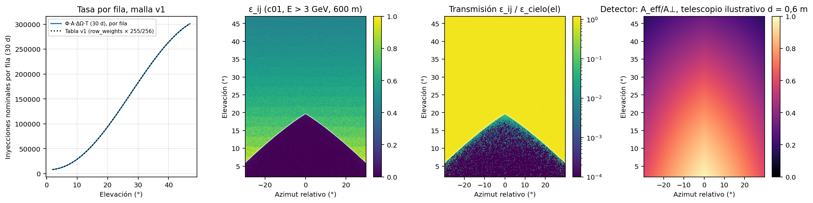

# Qué representa la imagen final: explicación y propuesta

2026-10-02. Responde a las observaciones F-01 y F-02 de la [revisión de la dirección](../../REVISION_FISICA_PRODUCCION_2026-10-02.md) y al [diagnóstico del observable](../../DIAGNOSTICO_OBSERVABLE_Y_DECISION.md). Las cifras salen de [relacion_conteos_exposicion.py](scripts/relacion_conteos_exposicion.py), que escribe [relacion-conteos-exposicion.json](resultados/relacion-conteos-exposicion.json) y la figura 9, a partir de los datos ya conservados: corridas c01 y c02 (trabajo 30626) y bloques de integración 108 y 109. **No se simuló nada nuevo para este documento.**

## 1. Por qué la semejanza entre planos grandes no prueba que la imagen sea la del detector de 1,2 m

El generador elige, para cada primario, una dirección nominal y un punto de impacto nominal x uniforme sobre el panel P de 1,2 × 1,2 m, y retrocede la trayectoria. El estimador cuenta:

C_b = Σ_{primarios con x ∈ P} 1[llega al plano S, E_cin > 3 GeV, dirección final ∈ b].

Un detector físico en la misma posición, expuesto a una fuente espacialmente amplia, cuenta:

D_b = Σ_{primarios con x ∈ ℝ²} 1[llega a P, E_cin > 3 GeV, dirección final ∈ b].

Al aumentar S de 100 a 300 y a 600 m, C_b converge cuando S contiene todos los desplazamientos x_final − x de los muones generados **sobre P**. Eso es lo que se observa: entre 100 y 600 m la diferencia es de 0,04 a 1,05 % por banda de roca con el corte de 3 GeV (c01). Es una convergencia del **muestreo**: el contador ya no pierde muones de esa fuente restringida. D_b, en cambio, incluye muones generados **fuera** de P que se desplazan hacia P y excluye los generados sobre P que salen de él. C = D solo si ambos flujos se compensan, lo que exige que la probabilidad de transporte no dependa de x en la escala del desplazamiento (invariancia lateral). La convergencia de C no informa sobre esa condición, porque ninguno de los muones que la pondrían a prueba se genera.

Los datos conservados muestran que el desplazamiento no es pequeño frente al panel. De los registros con E > 3 GeV en el cuadrado de 600 m, la fracción que llega dentro del panel de 1,2 m es de 70,4 / 11,2 / 14,7 / 14,5 / 3,6 % en las bandas de 10–30 / 30–60 / 60–100 / 100–200 / >200·10³ g/cm². Coincide con la tabla de la dirección. Esas fracciones **no son eficiencias de un detector**, porque falta la entrada desde fuera de P. Lo que sí muestran es que el término de compensación es grande y que su equivalencia debe demostrarse, no suponerse.

## 2. Comparación de las dos opciones

### 2a. Imagen de un estimador direccional idealizado

**Cantidad representada.** C_ij es el número de muones que llegan al plano de conteo con E_cin > 3 GeV y dirección de llegada en el píxel (i, j), por cada N_nom inyecciones nominales en la ventana. Equivale a un flujo direccional esperado sobre un área A⊥ = 1,44 m² normal a cada dirección, durante un tiempo convencional T (sección 4). Su forma adimensional es la **transmisión direccional** T_ij = ε_ij / ε_cielo(el_i), donde ε_ij = E[C_ij] / E[N_nom,ij]. En c01, ε_cielo vale 0,559 (filas de 20–42°) y la mediana de transmisión en roca de 3·10⁴–10⁵ g/cm² es 0,0138 (figura 9).

**Supuestos.**
- Fuente con la convención S0: dirección por pesos de Guan y forma espectral de EcoMug.
- Inyección 1 m antes de la roca y margen angular de 5°.
- Detección idealizada: sin tracker ni resolución, área normal a cada dirección, corte E_cin > 3 GeV en el plano.
- Física de Geant4 11.4.2 con FTFP_BERT y solo primarios.

**Ventajas para el aprendizaje.**
- Todas las imágenes del conjunto, de referencia y reducidas, son el mismo observable con la misma receta.
- La reducción binomial representa exactamente menos exposición del mismo estimador.
- El coste es tratable: unas 8.300 h-núcleo con k = 10.
- La imagen no depende de parámetros instrumentales que hoy no están fijados.

**Ventajas para la comparación física.**
- La transmisión es comparable directamente con la del surrogate (λ = Φ·A·ΔΩ·T) y con modelos de opacidad.
- No contiene artefactos de aceptación de un instrumento particular.

**Lo que no puede respaldar.**
- Tasas absolutas de un detector real ni «días de un detector».
- Efectos de resolución angular, aceptación finita o fondo instrumental.
- La contribución de muones generados fuera del panel nominal, mientras C3 no la demuestre.
- Una exposición física calibrada: la escala k·30 d es convencional.

### 2b. Reproducir la cuenta del detector de 1,2 m

**Área efectiva por dirección.**
- Un panel vertical de 1,2 m tiene área proyectada A·cos(el)·cos(az). Ponderado por la tasa, el factor medio es 0,785.
- Un telescopio de dos planos de lado L separados una distancia d tiene superficie de solapamiento (L − d|tan a_x|)(L − d|tan a_y|), con tan a_x = tan(az) y tan a_y = tan(el)/cos(az), proyectada por cos(el)·cos(az).
- Para separaciones ilustrativas d = 0,3 / 0,6 / 1,2 m, el factor medio sobre la ventana es 0,605 / 0,445 / 0,184.
- Con d = 1,2 m no hay aceptación por encima de 45° de elevación: el 7,6 % de los píxeles queda sin aceptación (figura 9, panel derecho, d = 0,6 m).

**Resolución angular.** Para planos con bandas de paso p, la resolución rms es ≈ p/(d·√6). Con p = 1 cm es de 0,78° / 0,39° / 0,19° para d = 0,3 / 0,6 / 1,2 m; con p = 4 cm, de 3,1° / 1,6° / 0,78°. Los píxeles miden 0,234° en azimut y 0,176° en elevación. Salvo con bandas finas y separación grande, la imagen de detector estaría suavizada en varios píxeles y la malla de 256 × 256 sobremuestrearía la información. **Los parámetros reales del instrumento (d, p, número de planos) no se fijan ni se verifican en esta entrega.**

**Estadística esperada por píxel.** Si la equivalencia se cumpliera, la cuenta del detector sería la del estimador multiplicada por el factor de área. Con k = 10, la mediana por ROI de 4 × 4 píxeles en roca, que es de 336 para el estimador, pasaría a unos 264 con panel vertical y a unos 150 con un telescopio de d = 0,6 m, antes de considerar la pérdida de resolución.

**Coste de simulación.** Una fuente espacial amplia de semilado g diluye la eficiencia por primario en un factor (2g)²/1,44 m². Para g = 50 m, cuadrado que contiene el ≥ 98,95 % de los registros de 600 m en todas las bandas, la dilución es de 6.944. Una producción equivalente a k = 10 costaría entonces unos 5,8·10⁷ h-núcleo, inviable. Una reconstrucción adjunta o hacia atrás podría reducir ese coste, pero no está implementada en la cadena actual y su coste no se ha evaluado.

## 3. Propuesta

**Adoptar la opción (a) como producto del OE1.** La imagen final es la del estimador direccional con E_cin > 3 GeV y la receta registrada (inyección junto a la roca, margen de 5°, plano de 600 m). Se declara como **conteo direccional sintético** con escala de exposición convencional, y su transmisión T_ij es la magnitud física de comparación. La opción (b) se trata como un **producto derivado**: D_ij = R[C_ij · A_eff,ij/A⊥], con R la respuesta instrumental (resolución y aceptación). Esa relación solo vale si se demuestra la equivalencia C ≈ D (control C3) y con parámetros de instrumento fijados.

**Justificación.**
- (i) El OE1 requiere pares de baja y alta estadística de un mismo observable bien definido, y (a) lo proporciona con un coste tratable. (b) es inviable a escala de campaña.
- (ii) La transmisión direccional es la magnitud que la muografía por transmisión invierte para obtener la opacidad, y es comparable con el surrogate.
- (iii) Separar la respuesta instrumental evita fijar parámetros de un detector que hoy no están establecidos.
- (iv) La propuesta no redefine el objetivo para evitar una validación. La afirmación «representa al detector de 1,2 m» queda explícitamente fuera hasta que C3 la demuestre.

**Comprobación que la sustentaría: control C3 en dos etapas, en geo-train-01, vista 0, con la receta de producción.**

1. **C3-a, escala de desplazamiento.** Añadir cuadrados anidados de 2, 5, 10 y 20 m de semilado a una corrida como c01: 2·10⁷ primarios, unas 3 h-núcleo. Se compara la fracción de registros de 600 m (E > 3 GeV) contenida en cada cuadrado, por banda. El semilado g de la fuente amplia se elige como el menor que contiene ≥ 99 % en todas las bandas.
2. **C3-b, equivalencia.** Usar una fuente con impacto nominal uniforme en un cuadrado de semilado g, contar solo en el panel central de 1,2 m y restringir las direcciones nominales a la banda de 3·10⁴–2·10⁵ g/cm² más 2° de margen. Sin el margen, esa banda recibe el 3,43 % de las inyecciones nominales; el margen lo aumenta en una cantidad no evaluada aquí. La restricción abarata el control sin perder la entrada desde fuera del panel.
   - **Magnitud comparada:** por banda de columna, R = [D/(N_G·A_P/A_G)] / [C/N_P], con el estimador corrido con las mismas direcciones e inyección.
   - **Objetivo estadístico:** 1.600 cuentas de panel en la banda de 30–60·10³ g/cm².
   - **Coste estimado** con el coste por evento de c01: 6,6 / 26 / 106 / 660 h-núcleo para g = 5 / 10 / 20 / 50 m. Es una estimación: el coste de las direcciones en roca puede diferir del promedio.
   - **Criterio fijado de antemano:** equivalencia si el intervalo simultáneo al 95 % de R (Bonferroni sobre las cuatro bandas, Poisson en ambos conteos) cabe completo en [0,95; 1,05]. Si lo cruza, el resultado es inconcluso; si queda fuera, no hay equivalencia.
   - **Código:** las opciones del parche de diagnóstico existentes (`OE1C_SUBPLANES_M`, `OE1C_INJECT=cone`, `OE1C_ECUTS_GEV`) cubren C3-a. C3-b requiere una opción nueva de fuente amplia (`OE1C_FUENTE_SEMILADO_M`) y otra de restricción de direcciones, que no existen todavía.

## 4. Relación entre conteos y tiempo de exposición

Para la opción (a):

E[C_ij] = T · A⊥ · ΔΩ_ij · Φ_ij · ε_ij

| Término | Definición | Cómo se calcula |
|---|---|---|
| Φ_ij | Flujo integral de Guan por encima de E_min = 0,798 GeV, el umbral CSDA de 367,5 g/cm² de aire, al cenit 90° − el_i. Independiente del azimut. | `comun.guan_integral`. Vale 6,82·10⁻⁵ / 1,22·10⁻³ / 3,67·10⁻³ cm⁻² s⁻¹ sr⁻¹ a 2° / 24,5° / 47°. |
| A⊥ | 1,44·10⁴ cm², normal a cada dirección. | Convención S0, sin proyección (C6). |
| ΔΩ_ij | (60/256)° × (45/255)° × cos(el_i), con 256 intervalos azimutales iguales y centros de elevación históricos. | Suma 0,73204 sr, igual al ángulo sólido exacto de la ventana con un error de 4·10⁻⁷. |
| T | Tiempo convencional: T = N_nom / Σ_ij Φ_ij A⊥ ΔΩ_ij = 30 d · N_nom / S0_v1. | S0_v1 = 36.034.069,91 (tabla v1); el recálculo da 36.036.311 (+6,2·10⁻⁵). Equivale a 13,90 inyecciones nominales/s. |
| N_nom | Primarios cuya dirección nominal cae en la ventana. Con margen es menor que el número de generados. | Se cuenta exactamente con el histograma `_gen` de cada bloque; no es una estimación. |
| ε_ij | Registros con E > 3 GeV en ij por inyección nominal en ij. Incluye transmisión, supervivencia, corte y migración entre píxeles. | Se obtiene de la propia simulación: ε_ij = C_ij / N_nom,ij (figura 9). |

**EcoMug no fija la normalización.** El generador solo usa su forma espectral condicionada a la elevación (cuantiles de `p_cdf.txt`). La tasa absoluta y la distribución en dirección vienen de la integral de Guan a través de S0. La comprobación de que el generador reproduce esa distribución por filas da, con 255 grados de libertad, χ² = 290,4 (p ≈ 0,06) para c01, 224,3 (p ≈ 0,92) para c02 y 265,1 (p ≈ 0,32) para la integración. Sumada sobre la imagen de c01, la relación reproduce el conteo total con un cociente de 1,00014.

**T para imágenes concretas.**

| Imagen | Generados | N_nom en ventana | T (días convencionales) |
|---|---:|---:|---:|
| c01, sin margen | 20.000.000 | 20.000.000 | 16,65 |
| c02, margen de 5° | 2.000.000 | 1.368.352 | 1,139 |
| Integración 108+109, margen de 5° | 200.000 | 136.657 | 0,1138 |
| Producción con k = 10 | 526.678.368 por vista | ≈ 360.340.699 | 300 |

Una imagen reducida con fracción f tiene exposición f·T. N_nom no tiene incertidumbre estadística, porque se cuenta. La incertidumbre de T es de **convención**: tomar la energía del umbral como cinética cambia S0 un −2,1 %; quitar el umbral de aire, +6,2 %; usar el área proyectada de un panel vertical, −21,5 % (figura 4). **T no es la duración de una medición de un detector real.**

## 5. Lo que queda sin demostrar

| Punto | Comprobación propuesta | Criterio |
|---|---|---|
| Equivalencia C ≈ D entre el estimador y un panel físico con fuente amplia (F-01) | C3-a y C3-b (sección 3) | Intervalo simultáneo al 95 % de R dentro de [0,95; 1,05] en las cuatro bandas |
| Que la escala k·30 d sea una exposición física (F-02) | Ninguna sin fijar el detector y la superficie de fuente; se declara convencional | La ficha de datos declara la convención y conserva `exposure_days=-1` en los bloques de N fijo |
| Consistencia de la forma espectral EcoMug con el flujo de Guan sobre la superficie de inyección junto a la roca | Comparar el espectro inyectado por banda con Guan restringido a la energía de entrada en roca | KS ≤ 0,05 por banda, o declarar EcoMug como forma adoptada y propagar la diferencia de Guan (KS 0,063–0,119, figura 5) como sistemático en la transmisión |
| Bordes con el observable final (F-03) | Evaluar C4 sobre el histograma con E > 3 GeV y réplicas independientes (semillas distintas) | Intervalos simultáneos de las filas y columnas de borde dentro de ±1 pp |
| Factor de conteo 0,124 fuera de geo-train-01 | Piloto P0 (geo-train-06) | Dentro del 20 % de 0,124 |
| Respuesta instrumental R (opción b) | Fijar d, p y número de planos del instrumento y validar R con una simulación del tracker | Fuera del alcance del conjunto (a) |
