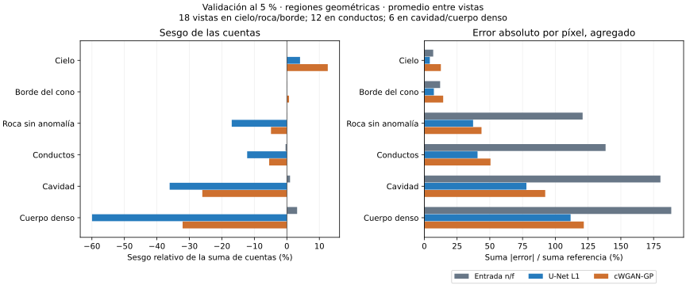

# Evaluación geométrica de cuentas y contrastes del piloto

Fecha de revisión: 2026-10-03, Colombia. **Estado: diagnóstico regional completado sobre validación; no constituye aceptación física ni cierre del OE2.**

Se continúa la [verificación de pesos e inferencia](REVISION_PESOS_PILOTO_F05.md) mediante regiones derivadas de las geometrías. Se analizaron las predicciones ya reproducidas de los dos checkpoints de época 5, la entrada reducida y las referencias: tres geometrías, seis vistas y veinte realizaciones por vista, con fracción \(f=0,05\). No se entrenó, no se ejecutó Geant4 y no se abrieron imágenes de prueba o generalización.

## Conclusión principal

Las métricas globales favorables no garantizan conservación regional de las cuentas. La U-Net reduce más el error absoluto por píxel, pero subestima las cuentas de roca y de las regiones proyectadas de anomalías. La cGAN tiene menor sesgo medio en esas regiones, aunque presenta mayor error absoluto y sobreestima más las cuentas de cielo. Ninguno de los dos resultados permite declarar resuelta la fidelidad física.



Las barras son promedios descriptivos entre vistas. La agrupación no convierte las vistas ni las veinte realizaciones en muestras independientes.

## Regiones fijadas por geometría

El [protocolo v1](configuraciones/protocolo-regiones-v1.json) se guardó antes de calcular estas métricas regionales. Las salidas de validación ya se habían observado en la revisión anterior; por ello no se presenta como una evaluación confirmatoria ciega ni como un registro previo al piloto.

Se verificaron las huellas de las tres geometrías contra la receta y los metadatos de los shards, además de las seis huellas de datos/metadatos contra el contrato OE2. Se utilizan centros angulares explícitos y rayos rectos desde la posición nominal del detector, a 1.000 m del eje y altura 1,5 m, para las seis orientaciones separadas 60°. La longitud máxima es 3.000 m.

Se calcula la intersección con el cono nominal, de radio superior 0,1 m, y con cilindros, esfera o elipsoide según el catálogo. Las anomalías se recortan al cono. Las máscaras representan proyecciones de primitivas geométricas; no asignan prioridades de material cuando se superponen ni reconstruyen trayectorias dispersadas.

- **Cielo:** rayos sin intersección con el cono, con erosión de dos píxeles.
- **Roca sin anomalía:** interior del cono, erosionado dos píxeles, excluyendo las proyecciones de anomalías dilatadas dos píxeles.
- **Borde:** diferencia entre dilatación y erosión de dos píxeles de la silueta del cono.
- **Anomalías:** longitud dentro de la primitiva recortada de al menos 20 m, con erosión de un píxel. Es un umbral geométrico de diagnóstico, no una resolución física certificada.

La vecindad de erosión/dilatación es cuadrada. Los límites exteriores de la imagen se tratan como falsos en la erosión. Las regiones no constituyen necesariamente una partición exhaustiva y disjunta; no deben sumarse sus cuentas como si lo fueran.

## Cuentas: definición y resultado

Se invierte la normalización de cada predicción antes de sumar o promediar:

\[
T(c)=\frac{\log(1+c)}{s+\log(1+c)},\qquad
\widehat c=\exp\!\left(\frac{s z}{1-z}\right)-1,\qquad
s=8,239329427901795.
\]

La entrada de comparación es \(n_{\mathrm{low}}/f\). Para una región \(R\), una realización \(k\) y una vista se calcula

\[
B_{R,k}=\frac{\sum_{p\in R}(\widehat c_{p,k}-c_p)}
                   {\sum_{p\in R}c_p},\qquad
E_{R,k}=\frac{\sum_{p\in R}|\widehat c_{p,k}-c_p|}
                   {\sum_{p\in R}c_p}.
\]

Se promedia primero entre las veinte realizaciones y después, sin ponderación, entre las vistas de cada tipo. El sesgo firmado puede compensarse entre vistas; la evidencia también conserva su magnitud absoluta y cada resultado individual. No son porcentajes del total de la campaña.

| Región | Vistas | Sesgo entrada | Sesgo U-Net | Sesgo cGAN |
|---|---:|---:|---:|---:|
| Cielo | 18 | −0,001 % | +4,06 % | +12,60 % |
| Borde del cono | 18 | −0,04 % | +0,03 % | +0,67 % |
| Roca sin anomalía | 18 | −0,04 % | −16,97 % | −4,89 % |
| Conductos | 12 | −0,40 % | −12,22 % | −5,44 % |
| Cavidad | 6 | +0,98 % | −36,07 % | −26,02 % |
| Cuerpo denso | 6 | +3,16 % | −59,96 % | −32,08 % |

| Región | Error absoluto entrada | Error absoluto U-Net | Error absoluto cGAN |
|---|---:|---:|---:|
| Cielo | 6,80 % | 4,22 % | 12,65 % |
| Borde del cono | 12,09 % | 7,32 % | 14,42 % |
| Roca sin anomalía | 120,83 % | 37,25 % | 43,67 % |
| Conductos | 138,36 % | 40,65 % | 50,53 % |
| Cavidad | 180,21 % | 77,94 % | 92,29 % |
| Cuerpo denso | 188,48 % | 111,66 % | 121,74 % |

Un error absoluto superior al 100 % es posible: su numerador suma errores por píxel y no está acotado por la suma de referencia. La entrada puede conservar aproximadamente la suma y, al mismo tiempo, presentar grandes fluctuaciones por píxel. Reducir esas fluctuaciones y preservar la suma son propiedades diferentes.

## Contraste con controles geométricamente comparables

Para cada núcleo de anomalía se excluyen rayos que atraviesen otra anomalía, con margen de dos píxeles. Cada píxel se compara con cinco píxeles de roca sin anomalía de la misma fila de elevación, escogidos por cercanía de longitud dentro del cono, con diferencia relativa máxima del 5 %. Los controles pueden reutilizarse y quedan ponderados por las asignaciones a los píxeles objetivo.

Se exige al menos veinte píxeles emparejados y cobertura mínima del 80 % del núcleo elegible. Las 24 combinaciones anomalía/vista cumplen ese soporte geométrico. Esto no garantiza estadística suficiente en cuentas ni igualdad exacta del transporte en objetivo y control.

El contraste se define mediante medias de cuentas:

\[
C_k=\frac{\overline c_{\mathrm{objetivo},k}}
          {\overline c_{\mathrm{control},k}}-1,\qquad
\Delta C_k=C_k-C_{\mathrm{ref}}.
\]

No es un contraste causal frente a la misma geometría sin anomalía: no se dispone aquí de ese contrafactual. Tampoco se presupone que la referencia de una anomalía menos densa deba presentar contraste positivo en todas las vistas.

En tres realizaciones de entrada del cuerpo denso, geo-val-03/vista 3, el control tiene cero cuentas. Su cociente se declara indefinido y no se añade pseudoconteo. Para una comparación con veinte cocientes válidos por método se informa el subconjunto común de 23 combinaciones:

| Método | Media del error absoluto de contraste |
|---|---:|
| Entrada \(n_{\mathrm{low}}/f\) | 24,64 puntos porcentuales |
| U-Net | 8,74 puntos porcentuales |
| cGAN | 9,07 puntos porcentuales |

La evidencia conserva además las 24 combinaciones y los tres cocientes indefinidos de entrada. En el conjunto de 24, el signo del contraste medio coincide con la referencia en 17 casos para entrada y 14 para cada red. Ese recuento no es una tasa de detección: varios contrastes de referencia son cercanos a cero, hay ruido y los controles no son independientes. Las redes reducen el error medio de contraste, pero no conservan automáticamente todos sus signos.

## Verificación y límites

- Ocho pruebas analíticas satisfactorias: cuerdas del cono, esfera, cilindro y elipsoide; tapas, tangencia, origen interior, recorte, orientación, morfología y ausencia de controles.
- Contraste independiente de longitudes mediante integración por puntos medios cada 0,25 m, en 128 rayos por vista: 2.304 rayos. Máxima diferencia de 0,2331 m, dentro de la cota de discretización de 0,5 m. No es una cota del error físico de la simulación ni una comparación de todos los rayos.
- Dieciocho mapas de máscaras, 234 registros región/método y 24 contrastes. Se conservan hashes de máscaras y de índices emparejados, así como de entradas y código.
- Python 3.12.14 y NumPy 2.3.5. Matplotlib 3.11.1 para la figura, inspeccionada visualmente. Se comprobó igualdad de métricas tras añadir los controles finales de procedencia.

Las referencias tienen estadística finita: los núcleos de cavidad reúnen entre 148 y 496 cuentas por vista; los del cuerpo denso, entre 114 y 297. Las realizaciones reducidas comparten esas referencias. No se calcularon intervalos suponiendo independencia de píxeles, vistas o realizaciones. Las diferencias no se presentan como una prueba de significación ni como estimaciones de densidad.

Los rayos centrales son una aproximación geométrica nominal. La dispersión y el plano computacional de conteo pueden desplazar la asociación entre dirección y volumen atravesado. Este diagnóstico permite evaluar conservación de imágenes sintéticas, pero no certifica respuesta instrumental ni detectabilidad de una anomalía real.

## Decisión y siguiente trabajo

**OE2-P04c: diagnóstico geométrico verificado; aceptación física parcial.** Ya existen máscaras reproducibles, medidas y resultados regionales. Sigue pendiente fijar tolerancias científicas justificadas para el uso pretendido y demostrar fidelidad suficiente; no se inventa ahora un umbral de aprobación a partir de los resultados.

**OE2-P04d: pendiente.** No se recomienda ampliar directamente a la campaña de 24 entrenamientos. El siguiente trabajo acotado consiste en diseñar y comparar un ajuste que penalice la pérdida de cuentas en roca y anomalías sin deteriorar cielo y bordes, manteniendo U-Net y cGAN actuales como referencias. La selección deberá considerar simultáneamente error de imagen, sesgo regional y contraste, no solo SSIM. Las métricas aquí fijadas deben conservarse y cualquier cambio registrarse antes de evaluar una nueva variante.

No se aplica un factor global de corrección: los sesgos difieren entre regiones e incluso de signo. Este diagnóstico no identifica por sí solo la causa del sesgo ni demuestra que cambiar un término de pérdida vaya a resolverlo. El diseño del ajuste precede a su ejecución. Los datos y pesos actuales bastan para prepararlo sin nuevas simulaciones; los conjuntos reservados permanecen fuera de la decisión.

## Evidencia y reproducción

- [Evaluación completa](evidencias/evaluacion-regiones-geometricas-v1.json).
- [Resumen descriptivo](evidencias/resumen-regiones-geometricas-v1.json).
- [Pruebas de geometría](evidencias/verificacion-geometria-regiones-v1.json).
- [Evaluador](herramientas/evaluar_regiones_geometricas.py), [pruebas](herramientas/test_regiones_geometricas.py) y [resumen/figura](herramientas/resumir_regiones_geometricas.py).

Desde la raíz del repositorio, tras generar las predicciones con el procedimiento de la revisión de pesos:

```powershell
python objetivo-2/herramientas/test_regiones_geometricas.py --geometrias objetivo-1/originales/scripts/simulation/geometry_catalog/geometries --protocolo objetivo-2/configuraciones/protocolo-regiones-v1.json --salida trabajo/pruebas-regiones.json
python objetivo-2/herramientas/evaluar_regiones_geometricas.py --protocolo objetivo-2/configuraciones/protocolo-regiones-v1.json --contrato objetivo-2/evidencias/contrato-datos-v1.json --receta objetivo-1/contratos/receta-operativa-siete-actividades.json --geometrias objetivo-1/originales/scripts/simulation/geometry_catalog/geometries --datos trabajo/drive-2026-10-03 --predicciones trabajo/revision-pesos-f05 --salida trabajo/regiones-geometricas-v1
python objetivo-2/herramientas/resumir_regiones_geometricas.py --evaluacion trabajo/regiones-geometricas-v1/evaluacion-regiones.json --salida trabajo/regiones-geometricas-v1
```

El evaluador exige un destino nuevo y rechaza huellas incompatibles; preservar bytes UTF-8/LF de archivos versionados. Los NPZ de máscaras y NPY de predicción se regeneran y permanecen fuera de Git. Las geometrías usadas en la revisión coinciden exactamente con la receta.

Incidencias registradas: persistieron archivos locales ilegibles, por lo que se recuperaron documentos y geometrías mediante GitHub y se usó el directorio aislado de la revisión. La primera ejecución se detuvo ante controles con cero cuentas; se hizo explícito su estado indefinido y se repitió el análisis completo. La exportación inicial del resumen requirió convertir un contador NumPy a entero JSON. Ambos procedimientos finalizaron correctamente después de esas correcciones. La copia local de Git no se declara reparada.
