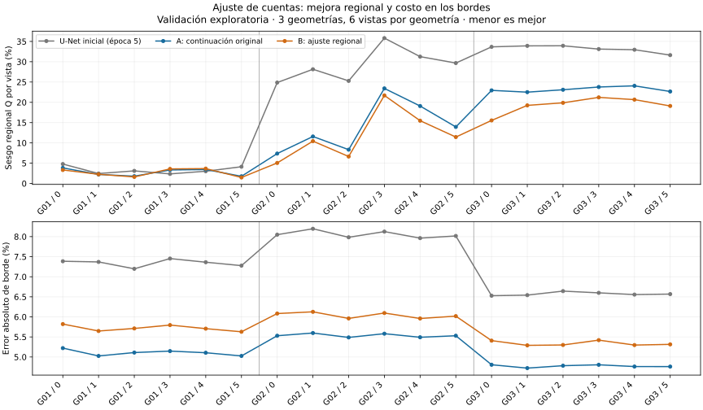

# Revisión independiente del ajuste U-Net al 5 %

Fecha de revisión: 2026-10-03, Colombia. Entrega estudiantil: rama oe2/ajuste-cuentas-f05, commit a6aa6b8d016a30ae5c6bcbc03fb423a5a750695d. Ejecución declarada: 2026-10-04 02:03–02:11 UTC, correspondiente al 3 de octubre en Colombia. Código utilizado: 66548a69bb21575323a4eaa2a9f805868f798a62.

**Resultado: ejecución e inferencia verificadas; compromiso científico confirmado.** La mejora del sesgo regional no satisface simultáneamente los criterios de borde y PSNR. El OE2 permanece abierto. No se autoriza ampliar automáticamente ni se modifica el cierre del OE1.

## Evidencia examinada

Se revisó el [informe estudiantil fijado por commit](https://github.com/anlegogo/muografia-documentada/blob/a6aa6b8d016a30ae5c6bcbc03fb423a5a750695d/objetivo-2/entregas/2026-10-03-ajuste-cuentas-f05/RESULTADOS_AJUSTE_CUENTAS_F05.md) y se descargaron los doce binarios de su [distribución Drive](https://drive.google.com/drive/folders/1pdXdTSdE2tl5Jiaxn7WqC_yXWQswxl_e): seis checkpoints y seis arreglos de predicciones. Coinciden los doce tamaños y SHA-256 publicados. Se verificaron además 137 archivos de texto contra el inventario de la entrega. Las figuras recibidas no forman parte de ese recuento; la figura de esta revisión fue generada e inspeccionada independientemente.

Se cargaron los seis checkpoints con weights_only=True. Las cuatro ejecuciones técnicas reproducen exactamente generador, optimizador, RNG CPU/CUDA, registros numéricos y predicciones entre ejecución continua y recuperada. Esto audita los artefactos de la ejecución GPU recibida; no implica que se haya repetido el entrenamiento GPU localmente.

Ambas variantes principales contienen cinco épocas adicionales completas, 1.800 actualizaciones por rama, mismo orden, configuración compatible y selección de la quinta época. Se contrastaron datos, normalización, código y pesos iniciales. No se seleccionó retrospectivamente una época más favorable.

La auditoría local utilizó CPU, Python 3.12.14, PyTorch 2.6.0+cpu y NumPy 2.3.5. Se repitieron 360 inferencias por variante, 720 en total, sin optimización. Las tolerancias fijadas antes de ejecutar fueron: diferencia máxima de píxel normalizado ≤ 10^-5, diferencia de SSIM medio ≤ 10^-6 y diferencia de PSNR medio ≤ 10^-4 dB. Ambas variantes cumplen: la diferencia máxima de píxel es 3,55×10^-6 para A y 3,83×10^-6 para B; las diferencias de SSIM medio son menores de 3,5×10^-9 y las de PSNR menores de 2,0×10^-7 dB.

Se recalculó la evaluación completa desde las predicciones descargadas, incluidos sesgos, contraste y métricas por imagen. El mayor desacuerdo numérico es 4,45×10^-16, compatible con el redondeo de coma flotante. La clasificación también se conserva al evaluar las predicciones CPU.

El análisis complementario fue contrastado mediante 5.400 errores de cuentas recalculados desde los datos y predicciones de entrada/A/B: diferencia máxima 3,06×10^-16. Se reprodujeron 168 estadísticas del CSV y 21 valores del bootstrap con diferencia cero. Los registros iniciales del CSV se verificaron aritméticamente; el diagnóstico del modelo inicial utiliza sus predicciones CPU previamente verificadas e identificadas por SHA-256.

La [evidencia de auditoría](evidencias/revision-ajuste-a6aa6b8.json), el [diagnóstico por vista](evidencias/diagnostico-ajuste-a6aa6b8.json) y los scripts de reproducción permiten distinguir verificación binaria, recálculo e interpretación.

## Resultado principal

Q resume magnitudes del sesgo medio de roca y anomalías, con la ponderación por vista y geometría fijada en el diseño. No es error de densidad ni error absoluto de cada píxel.

| Medida | Entrada | U-Net inicial | A: continuación | B: regional |
|---|---:|---:|---:|---:|
| Q (%) | 1,814 | 21,896 | 13,287 | 11,239 |
| Error absoluto espacial de borde (%) | 12,092 | 7,323 | 5,138 | 5,699 |
| Error de contraste, 23 combinaciones comunes | 0,24644 | 0,08744 | 0,08680 | 0,08345 |
| SSIM | 0,751812 | 0,843671 | 0,842971 | 0,843064 |
| PSNR (dB) | 24,16773 | 32,90365 | 32,81883 | 32,76862 |

Los valores iniciales corresponden a la inferencia CPU previamente verificada, por lo que no se interpretan diferencias CPU/GPU diminutas como efectos científicos.

B reduce Q frente a A en 2,048 puntos porcentuales, 15,41 % relativo. Mejora Q en las tres geometrías y en 15 de las 18 vistas. Empeora el error de borde frente a A en las 18 vistas; el aumento global es 0,560 puntos. La diferencia de PSNR es −0,0502 dB. No se cambia la regla previamente fijada para aceptar ese deterioro como equivalencia.

La continuación A por sí sola reduce Q desde 21,896 % a 13,287 %. Por tanto, atribuir toda la mejoría al término regional confundiría el efecto de continuar con una tasa menor y el efecto específico de la penalización. Ambas continuaciones quedan por debajo del SSIM y PSNR iniciales, aunque mejoran otras medidas regionales.



## Deterioros que el promedio puede ocultar

La región del cuerpo denso en geo-val-03 requiere atención específica:

| Sesgo firmado medio en esa región | U-Net inicial | A | B |
|---|---:|---:|---:|
| Promedio sobre seis vistas y veinte realizaciones por vista | −59,96 % | −77,75 % | −70,23 % |

B mejora frente a A, pero sigue peor que el modelo inicial en cinco de las seis vistas de ese cuerpo. El descenso de Q global no demuestra recuperación adecuada de cada anomalía. El porcentaje se refiere a cuentas respecto de la referencia idealizada; no debe convertirse en porcentaje de error de densidad.

También debe distinguirse conservación regional de fidelidad espacial. Frente a A, B reduce el sesgo regional, pero el error absoluto espacial medio de roca cambia de 33,57 % a 34,00 %, y el de las regiones de anomalía de 63,43 % a 64,18 %. Acercar la suma de cuentas de una región no garantiza mejorar cada píxel.

Para una región R y una realización, son magnitudes diferentes:

- Error relativo de la suma: |sum_R(predicción − referencia)| / sum_R(referencia).
- Error absoluto espacial: sum_R |predicción − referencia| / sum_R(referencia).

La primera permite compensación entre píxeles; la segunda no. Q utiliza sesgos promediados entre realizaciones y otra agregación por vista/geometría, por lo que tampoco coincide con la primera magnitud por imagen.

El −23,96 % de sesgo medio de anomalías del informe principal y el −9,73 % del análisis complementario B no constituyen una contradicción: uno promedia regiones de anomalía individualmente; el otro reúne sus píxeles y calcula el error de la unión, ponderado por las cuentas de referencia. Se deben mantener nombres y fórmulas explícitos.

La entrada tiene un Q mucho menor que las redes. Esto es compatible con el adelgazamiento binomial reescalado y su insesgamiento en esperanza, aunque la imagen sea más ruidosa. El objetivo requiere considerar conjuntamente ruido, sesgo, estructura y contraste.

## Interpretación y cumplimiento

| Pendiente | Estado después de la revisión |
|---|---|
| Ajuste-01: integración U-Net | Verificado en la revisión anterior. |
| Ajuste-02: ejecución GPU y recuperación | Verificado mediante auditoría directa de los checkpoints y registros recibidos. |
| Ajuste-03: comparación de cinco épocas | Ejecución y evaluación verificadas; resultado de compromiso, sin aceptación física. |
| OE2-P04d: ajuste acotado antes de ampliar | Ensayo U-Net completado y revisado; campaña principal y demostración de desempeño pendientes. |
| Cumplimiento global del OE2 | Parcial: falta consolidar la evaluación de cGAN y la evidencia final dentro del alcance acordado. |

La pérdida regional funciona como hipótesis implementada y modifica el resultado en la dirección buscada para Q. No queda establecida como mejora general ni se justifica seleccionar B como modelo definitivo. Una sola ejecución por rama no estima variabilidad de entrenamiento.

Los intervalos complementarios proceden de remuestreo de tres geometrías y sus vistas. Son descriptivos y no incorporan semillas independientes, incertidumbre física ni independencia entre referencias compartidas. No contienen una prueba de equivalencia ni demuestran generalización.

El informe estudiantil afirma que el término regional no añadió costo medible. Los tiempos registrados son aproximadamente 174,1 s para A y 175,5 s para B, pero A también calcula el diagnóstico regional y una sola ejecución no aísla el costo de añadirlo a un entrenamiento L1 optimizado. La conclusión admisible es que se observaron tiempos próximos en esta implementación y equipo.

## Próximo paso

Se deja una [propuesta acotada de continuación cGAN](PROPUESTA_CONTINUACION_CGAN_F05.md), conservando un control que también continúe entrenándose. Su finalidad es evaluar la hipótesis en la arquitectura nombrada por el OE2, sin asumir que el resultado U-Net se transfiere.

Antes de enviar otra orden de entrenamiento se requiere implementar y verificar ese ejecutor: el actual ajuste U-Net no actualiza un crítico. La propuesta mantiene explícitos los deterioros por anomalía y no sustituye la revisión por una búsqueda de hiperparámetros. No hace falta pedir nuevos archivos para completar esta auditoría.

## Reproducción e incidencias

Se incorporan [revisor de checkpoints e inferencia](herramientas/revisar_ajuste_entregado.py), [diagnóstico por vista](herramientas/diagnosticar_ajuste_entregado.py) y [verificador complementario](herramientas/verificar_complementario_ajuste.py). Desde la raíz, con binarios y registros de la entrega juntos en ENTREGA/datos y una caché de máscaras verificada:

```bash
python objetivo-2/herramientas/revisar_ajuste_entregado.py --repo . --datos DATA --mascaras MASCARAS --entrega ENTREGA/datos --salida REVISION
python objetivo-2/herramientas/diagnosticar_ajuste_entregado.py --repo . --datos DATA --mascaras MASCARAS --entrega ENTREGA/datos --predicciones-iniciales PREDICCIONES_UNET_INICIAL --salida DIAGNOSTICO
python objetivo-2/herramientas/verificar_complementario_ajuste.py --repo . --datos DATA --mascaras MASCARAS --entrega ENTREGA/datos --salida REVISION/complementario-verificado.json
```

El primer revisor requiere una carpeta de salida y el tercero que su carpeta padre exista. Se usan rutas propias, sin copiar literalmente rutas temporales de la revisión. Las predicciones iniciales reutilizadas corresponden al SHA-256 c4e35ef07c46974b4847ec46ea60173c6f1a44e1c6f33f0639f2aea2e58ec9fc, documentado en la revisión previa.

Las máscaras locales y las declaradas por los estudiantes tienen idénticas huellas de contenido en las quince geometrías, reglas y soportes. Los bytes de los NPZ comprimidos difieren y, por ello, también el manifiesto completo. La revisión comprueba explícitamente equivalencia de contenido y conserva ambas identidades; no altera un checkpoint para hacer coincidir hashes.

La copia de trabajo en D: volvió a fallar con un error de dispositivo. Se completó la revisión en una carpeta temporal de C:, sin reparar el índice Git ni modificar originales. La referencia de descarga temporal del conector devolvió HTTP 403; se descargaron los mismos IDs públicos directamente desde Drive y se verificaron sus huellas. La extracción de texto introdujo diferencias de representación: se restauraron finales de línea verificados y un TSV mediante los bytes base64 del objeto Git; los 137 textos coinciden finalmente. Una copia local incompleta del antiguo checkpoint cGAN produjo EOF y se descartó; la copia previamente confirmada contiene generador y crítico y conserva su SHA-256 correcto.

No se ejecutaron entrenamientos, no se modificaron los checkpoints recibidos y no se abrieron imágenes test/generalization.
