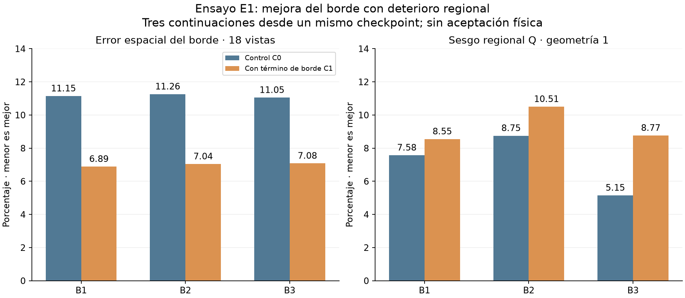

# Revisión independiente y diagnóstico del ensayo E1

Fecha de ejecución estudiantil y revisión: 2026-10-04, America/Bogota. Entrega [804ce85](https://github.com/anlegogo/muografia-documentada/tree/804ce85f1bcb1e00d0956ae6bef26e69dd50130a/objetivo-2/entregas/2026-10-04-borde-cgan-f05); código ejecutado `156d4f5699f500c692d466f56c48ca25bda79c0c`. No se fusiona ni modifica la rama estudiantil.

## Dictamen

**E1 queda ejecutado y revisado como ensayo acotado, con resultado de compromiso.** El término espacial reduce el error del borde en todas las vistas y parejas, pero ninguna pareja satisface los nueve controles fijados. No corresponde repetir automáticamente E1, prolongar épocas ni promover C1 como modelo final. El cierre de este ensayo no equivale al cierre del OE2 ni a aceptación física.

El resultado permite documentar una mejora específica y sus limitaciones. La siguiente actividad es la consolidación reproducible y la discusión de resultados descritas en las [instrucciones vigentes](INSTRUCCIONES_CIERRE_E1.md). No se prescribe otro entrenamiento con un coeficiente escogido después de ver validación.

## Auditoría de la entrega

- Carpeta Drive: 58 archivos visibles; 55 binarios más tres auxiliares. Los 55 binarios se descargaron y verificaron por ruta, tamaño y SHA-256: **5.910.537.694 bytes**.
- Se verificaron 186 blobs de texto Git y 185 entradas del manifiesto de huellas; los nueve PNG originales no se descargaron por limitación del conector. Las figuras propias siguientes se regeneraron desde los arreglos verificados.
- Los 18 checkpoints cumplen identidad, fuentes, configuración e integridad: doce técnicos y seis finales. En B1–B3 se comprobó recuperación exacta de G, D, ambos Adam, estados aleatorios, historial numérico y predicciones. Se auditaron artefactos CUDA recibidos; no se repitió el entrenamiento GPU.
- Se verificaron train/val, pesos iniciales y las quince máscaras. Se recalcularon **5.334 campos flotantes por pareja** y la síntesis. Se reprodujeron **2.520 imágenes en CPU**, reutilizando la inferencia inicial idéntica al contrastar las otras dos parejas. Máximo absoluto CPU/CUDA: `8.702278137207031e-06`, inferior a `1e-4`; SSIM y PSNR cumplen `1e-5` y `1e-3 dB`. Estas tolerancias de inferencia no sustituyen la igualdad exacta de recuperación.
- No se entrenó durante la revisión ni se abrieron test/generalización. La rama agrega 195 archivos de entrega, sin modificar entrenamiento o configuraciones frente al código citado.

[Auditoría completa](evidencias/revision-e1-804ce85.json), [integridad de descargas](evidencias/integridad-e1-804ce85.json), [listado de Drive](evidencias/listado-drive-e1.json) y [auditor reproducible](herramientas/verificar_binarios_borde_cgan.py).

## Resultado global y por vista

| Pareja | Borde C0 → C1 (%) | Reducción relativa | Vistas con mejor borde | Vistas con menor Q | Controles cumplidos |
|---|---:|---:|---:|---:|---:|
| B1 | 11,146 → 6,891 | 38,17 % | 18/18 | 14/18 | 6/9 |
| B2 | 11,263 → 7,045 | 37,45 % | 18/18 | 9/18 | 7/9 |
| B3 | 11,052 → 7,084 | 35,90 % | 18/18 | 6/18 | 5/9 |

Son 18 vistas repetidas en tres parejas de continuación desde el mismo checkpoint; no 54 geometrías independientes. Q global mejora en B1/B2 y empeora en B3. El Q de `geo-val-01` aumenta en las tres parejas. No se excluye ninguna vista ni se escoge una semilla ganadora. La síntesis recalculada es `dependencia_de_semilla_o_compromiso`, con `physical_acceptance: false`.



La entrada tiene menor Q que las continuaciones, pero peor calidad estructural. Q mide sesgo regional agregado: el ruido puede cancelarse al sumar y promediar realizaciones. No equivale a fidelidad píxel a píxel ni a error de densidad. Del mismo modo, mejorar el borde no acredita conservar la señal del interior.

## Diagnóstico espacial adicional

Se invirtió la normalización antes de promediar las veinte realizaciones de cada vista:

\[
\widehat c_{kp}=\exp\!\left(\frac{s z_{kp}}{1-z_{kp}}\right)-1,\qquad
\overline e_p=\frac1{20}\sum_{k=1}^{20}\widehat c_{kp}-c_p,
\qquad s=8{,}239329427901795.
\]

Para cada región R se calculó el sesgo firmado

\[
b_R=\frac{\sum_{p\in R}\overline e_p}{\sum_{p\in R}c_p}
=\underbrace{\frac{\sum_{p\in R}\max(\overline e_p,0)}{\sum_{p\in R}c_p}}_{b_R^+}
+\underbrace{\frac{\sum_{p\in R}\min(\overline e_p,0)}{\sum_{p\in R}c_p}}_{b_R^-}.
\]

Se verificaron 252 sesgos contra las tablas auditadas, con diferencia menor que `1e-12`, para las tres geometrías de validación, seis vistas y ambas variantes de las tres parejas. El error absoluto del promedio no se confunde con el promedio del error absoluto por realización.

### Geometría 1

| Pareja | Roca: sesgo medio C0 → C1 (%) | Conducto: sesgo medio C0 → C1 (%) | Vistas con deterioro roca / conducto |
|---|---:|---:|---:|
| B1 | 5,383 → 6,662 | 9,769 → 10,446 | 6/6 y 3/6 |
| B2 | 7,007 → 7,645 | 10,500 → 13,367 | 6/6 y 6/6 |
| B3 | 4,749 → 4,911 | 5,559 → 12,623 | 5/6 y 6/6 |

C1 presenta exceso firmado de cuentas en las seis vistas de ambas regiones en cada pareja. El deterioro no es universal en cada vista: B1 conserva tres vistas del conducto sin empeoramiento; B3 conserva una vista de roca. El promedio por geometría no debe ocultar estas excepciones.

Para localizar el efecto se dividieron las regiones por distancia euclidiana al soporte de la máscara de borde: 0–2, 2–8 y más de 8 píxeles. Son bandas exploratorias de la malla angular, no distancias físicas ni umbrales de aceptación. Cada contribución usa el mismo denominador regional, de modo que las bandas suman el sesgo total; no se normalizan por referencias pequeñas de cada banda.

En el conducto, la banda a más de ocho píxeles contribuye **9,779, 12,959 y 12,034 puntos porcentuales** al sesgo C1 de B1, B2 y B3, respectivamente. La mayor parte del exceso integrado se localiza en el interior. También concentra la mayor parte de las cuentas de referencia del conducto; por tanto, esta contribución no demuestra que cada píxel interior tenga mayor error relativo que los cercanos al borde. No se infiere una causa en gradientes, arquitectura o muestreo a partir de estos mapas.

Las figuras muestran todas las vistas de geometría 1 y el contorno del conducto. Los errores usan escala simétrica logarítmica, lineal entre −1 y +1 cuenta; la escala incluye todos los valores mostrados. Las coordenadas son índices de la malla angular. JPEG es una vista de consulta; el script regenera PNG y conserva cifras completas en JSON.

- [Mapas B1](figuras/e1-mapas-B1-geo1.jpg).
- [Mapas B2](figuras/e1-mapas-B2-geo1.jpg).
- [Mapas B3](figuras/e1-mapas-B3-geo1.jpg).
- [Diagnóstico completo](evidencias/diagnostico-interiores-e1.json), [contribuciones por banda](evidencias/bandas-interiores-e1.csv) y [análisis de las 54 comparaciones](evidencias/vistas-e1.json).

## Correcciones documentales sin alterar originales

Se publica una [fe de erratas y correspondencia de rutas](evidencias/fe-erratas-e1.json), conservando el antes, después y SHA-256:

1. El informe original declara 5.952.730.120 bytes; la suma verificada es 5.910.537.694. Diferencia: 42.192.426 bytes. No faltan binarios.
2. Siete registros aparecen en `logs-locales/` dentro del inventario, pero están en la raíz de `datos/ensayo-borde-e1/` en GitHub. Sus bytes y huellas coinciden.

No se cambia el manifiesto original ni se recalculan sus huellas como si hubiera sido correcto desde el inicio. La fe de erratas es el índice de lectura corregido de esta revisión; los autores deben reconocerla en su siguiente entrega.

## Estado de pendientes y decisión

| Identificador | Estado y evidencia | Siguiente paso |
|---|---|---|
| E1-04 | Verificado en GPU mediante los artefactos recibidos y recuperación exacta. | Conservar estados y entorno. |
| E1-05 | Seis continuaciones y evaluación completadas; auditoría independiente verificada. | No repetir E1; consolidar discusión. |
| E1-D01 | Corrección de tamaño y rutas registrada en la fe de erratas. | Reconocimiento de los autores, sin sustituir originales. |
| E1-D02 | Diagnóstico espacial verificado; efecto localizado, mecanismo causal no establecido. | Reproducción estudiantil y discusión descriptiva. |
| OE2-P04 | Evidencia de piloto ampliada; desempeño final y comparabilidad de alta estadística aún parciales. | Fijar protocolo y criterio científico antes de abrir reservas. |

Se conserva el criterio original de nueve controles: el resultado no se convierte retrospectivamente en aprobado. No se propone un nuevo coeficiente ni una búsqueda de semillas. Una comparación válida puede mostrar compromisos; esto no basta por sí solo para acreditar la calidad comparable exigida por el objetivo.

## Reproducción

El entorno local fue Python 3.12.14, NumPy 2.3.5 y PyTorch 2.6.0+cpu para la auditoría previa. El diagnóstico nuevo usa NumPy, SciPy y Matplotlib; no requiere CUDA ni checkpoints de entrenamiento. Se usa el mismo código de datos y la misma caché verificada. El siguiente comando, adaptando rutas, se ejecutó correctamente:

```bash
python objetivo-2/herramientas/diagnosticar_interiores_e1.py \
  --auditoria objetivo-2/evidencias/revision-e1-804ce85.json \
  --entrega /ruta/entrega/2026-10-04-borde-cgan-f05 \
  --binarios /ruta/oe2-borde-cgan-f05 \
  --datos /ruta/insumos --salida /ruta/nueva/diagnostico-e1
```

La salida debe ser nueva. Se verifican las seis huellas de predicciones finales y el contrato de datos antes de analizar. `entrega` contiene `datos/ensayo-borde-e1`; `binarios` contiene B1–B3 y `mascaras-ajuste-v1`; `datos` contiene `dataset-v2/shards`. No se mezclan las figuras originales con las generadas aquí.

El [índice de artefactos finales](INDICE_ARTEFACTOS_E1.md) permite localizar los seis checkpoints y sus predicciones sin seleccionar una semilla.
