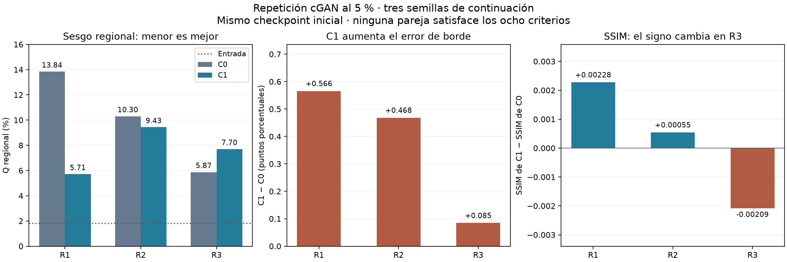

# Verificación independiente de la repetición cGAN R1–R3

Fecha de revisión: 2026-10-04, America/Bogota. **Estado: entrega técnica e inferencia verificadas; resultado dependiente de la semilla o de compromiso, sin aceptación física.** El OE2 permanece abierto.

## Procedencia y alcance

Se revisó la entrega estudiantil [f6518ff](https://github.com/anlegogo/muografia-documentada/tree/f6518ff2aceb695129bfd8773ce58f6479395def/objetivo-2/entregas/2026-10-04-repeticion-cgan-f05), ejecutada con el código fd20c67, y sus [binarios de Drive](https://drive.google.com/drive/folders/19H0ByGPw8zhwLQdzqWcqpMmt4A-OhhDW). Se conservaron las entregas originales y la rama estudiantil; no se fusionó su rama ni se repitió entrenamiento.

La ejecución estudiantil utilizó tres L40S del mismo modelo, una por pareja. Cada pareja conservó su GPU en las pruebas técnicas y en C0/C1; las tres evaluaciones se realizaron en secuencia sobre la GPU 0. Las tres aceptaciones preceden al lanzamiento de las continuaciones según los registros. La revisión local verifica los artefactos GPU e infiere en CPU; no constituye una nueva ejecución CUDA.

## Integridad y recuperación

Se descargaron **55 archivos, 5.910.526.686 bytes**, y coincidieron todos los tamaños y SHA-256: 18 checkpoints, 21 arreglos de predicciones y la caché de máscaras con su manifiesto y 15 NPZ. Se verificaron también 193 textos contra sus objetos Git; 192 están incluidos en el manifiesto de la entrega, cuyo propio archivo constituye el texto restante. Los 15 gráficos originales no se incluyen en ese conteo: se regeneró y contrastó el diagnóstico por pareja.

Desde los doce checkpoints técnicos se confirmó igualdad exacta de generador, crítico, ambos optimizadores, estados aleatorios, historiales numéricos y predicciones entre ejecución continua y recuperada. Coinciden las identidades y huellas con las tres aceptaciones publicadas.

Las seis continuaciones terminaron en la quinta época, con selección fija de esa época y sin reanudaciones. Se comprobaron las configuraciones, fuentes, datos, máscaras, pesos iniciales y contadores: **10.800 actualizaciones G y 54.000 D** en las continuaciones; **48 G y 240 D** en las pruebas técnicas. Las quince máscaras coinciden píxel por píxel con la caché previamente verificada.

## Reproducción numérica

Se recalcularon **16.002 campos numéricos** de las evaluaciones y **5.140** de los diagnósticos por vista y anomalía; las diferencias absolutas máximas fueron 6,67e-16 y 8,89e-16, respectivamente. También se reprodujo la síntesis de las tres parejas.

Se realizaron **2.520 inferencias CPU**: 360 imágenes para cada una de las seis continuaciones y 360 para el modelo inicial. La inferencia inicial se reutilizó únicamente tras contrastarla con las tres exportaciones iniciales entregadas. La máxima diferencia absoluta por píxel frente a las predicciones CUDA fue 6,885e-6; las diferencias máximas de SSIM y PSNR fueron menores de 6,64e-9 y 3,11e-7 dB. Todos los controles quedaron dentro de las tolerancias fijadas.

La tolerancia de inferencia CPU frente a CUDA se mantiene en máximo absoluto de píxel 1e-4, SSIM 1e-5 y PSNR 1e-3 dB. Estas tolerancias no se aplican a la recuperación técnica, que exige igualdad exacta.

La [evidencia completa](evidencias/revision-repeticion-f6518ff.json) conserva las huellas, los controles por pareja, las diferencias numéricas, la síntesis y los diagnósticos locales.

## Resultado científico

Se conserva la definición prospectiva de Q: promedio entre geometrías del indicador que asigna igual peso a roca y anomalías; dentro de cada componente se promedian los valores absolutos del sesgo medio por región, con igual peso por vista y, en cada vista, por anomalía. Q es un indicador de sesgo de cuentas, no una medida global de calidad visual. C0 es la continuación sin penalización regional y C1 incorpora esa penalización con peso uno. Ambas parten del mismo checkpoint y reciben cinco épocas adicionales.

| Pareja | Q de C0 | Q de C1 | Cambio C1−C0 | Cambio de error de borde | Controles satisfechos |
|---|---:|---:|---:|---:|---:|
| R1 | 13,841 % | 5,711 % | −8,130 puntos porcentuales | +0,566 puntos porcentuales | 7/8 |
| R2 | 10,300 % | 9,434 % | −0,866 puntos porcentuales | +0,468 puntos porcentuales | 5/8 |
| R3 | 5,871 % | 7,700 % | +1,829 puntos porcentuales | +0,085 puntos porcentuales | 1/8 |

C1 reduce Q en dos parejas y lo aumenta en la tercera. El error de borde aumenta en las tres. La mediana del cambio de Q es −0,866 puntos porcentuales, con rango [−8,130; +1,829]; tres continuaciones condicionadas no justifican significación estadística ni una afirmación de generalización.

Frente a la entrada sin red, el menor ruido visual no implica mejor conservación de cuentas: Q de la entrada es 1,814 %, inferior al de las seis continuaciones. Frente a la cGAN inicial, C1 empeora PSNR en las 18 vistas de cada pareja y SSIM en 17, 18 y 18 vistas de R1, R2 y R3, respectivamente.

Se reproduce la clasificación prospectiva `dependencia_de_semilla_o_compromiso`: **cero parejas cumplen los ocho controles completos**. El resultado favorable del antecedente no se repite como mejora concordante.



[Figura en PDF](figuras/sintesis-repeticion-verificada.pdf). En los cambios de borde, un signo positivo indica deterioro; en SSIM, uno negativo indica deterioro.

El diagnóstico por anomalía mantiene las dificultades del cuerpo denso de geo-val-03. Los máximos sesgos medios de C1 son aproximadamente +39,4 % en R1, +62,4 % en R2 y +54,7 % en R3. Se conservan los soportes y las referencias pequeñas en el informe original. Estos son errores de cuentas sobre referencias idealizadas, no errores de reconstrucción de densidad.

## Implicación para el OE2

Se cierra la revisión técnica de esta entrega y se confirma que el ensayo respondió a la pregunta de estabilidad. No se concede aceptación física, no se declara cumplido el OE2 y no se amplía la campaña.

Antes de solicitar más entrenamiento corresponde revisar el diseño científico y fijar tolerancias de conservación de cuentas, borde y contraste justificadas por el uso previsto. No se selecciona retrospectivamente R1 ni se compensa R3 con más épocas. Los resultados no identifican por sí solos la causa del compromiso; una modificación posterior debe formular una hipótesis y un criterio prospectivo.

## Reproducción y contingencias

El [verificador](herramientas/verificar_binarios_repeticion_cgan.py) recibe rutas explícitas. La carpeta de entrega contiene los textos extraídos del commit f6518ff; la de binarios conserva la estructura de Drive. La referencia de máscaras debe ser la caché previamente verificada, independiente de la copia recién descargada. La salida debe ser nueva.

```bash
python objetivo-2/herramientas/verificar_binarios_repeticion_cgan.py \
  --entrega /ruta/entrega-f6518ff \
  --binarios /ruta/binarios-drive \
  --datos /ruta/insumos-train-val \
  --pesos /ruta/cgan-original-epoca5.pt \
  --mascaras-referencia /ruta/mascaras-previamente-verificadas \
  --salida /ruta/revision-nueva
```

La figura de síntesis se reproduce con [graficar_revision_repeticion_cgan.py](herramientas/graficar_revision_repeticion_cgan.py), pasando `--evidencia /ruta/revision-nueva/revision-independiente.json --salida /ruta/figuras-nuevas`.

El procedimiento verifica huellas, estados completos, evaluación, inferencia y síntesis. Reproduce la auditoría de la versión de entrenamiento fd20c67; cambios posteriores de fuentes pueden requerir recuperar esa versión. Se utilizan las dependencias ya documentadas para la continuación cGAN.

El conector de Drive rechazó los checkpoints por su límite de 256 MiB; se descargaron completos mediante sus enlaces públicos. La copia antigua de los datos en D: presentó errores de lectura; se recuperaron los 30 archivos train/val (403.721.028 bytes) y se comprobaron contra el contrato fijado. Se trabajó en una carpeta temporal de C:, sin reparar ni alterar el índice Git original. No se abrieron imágenes test/generalization.
