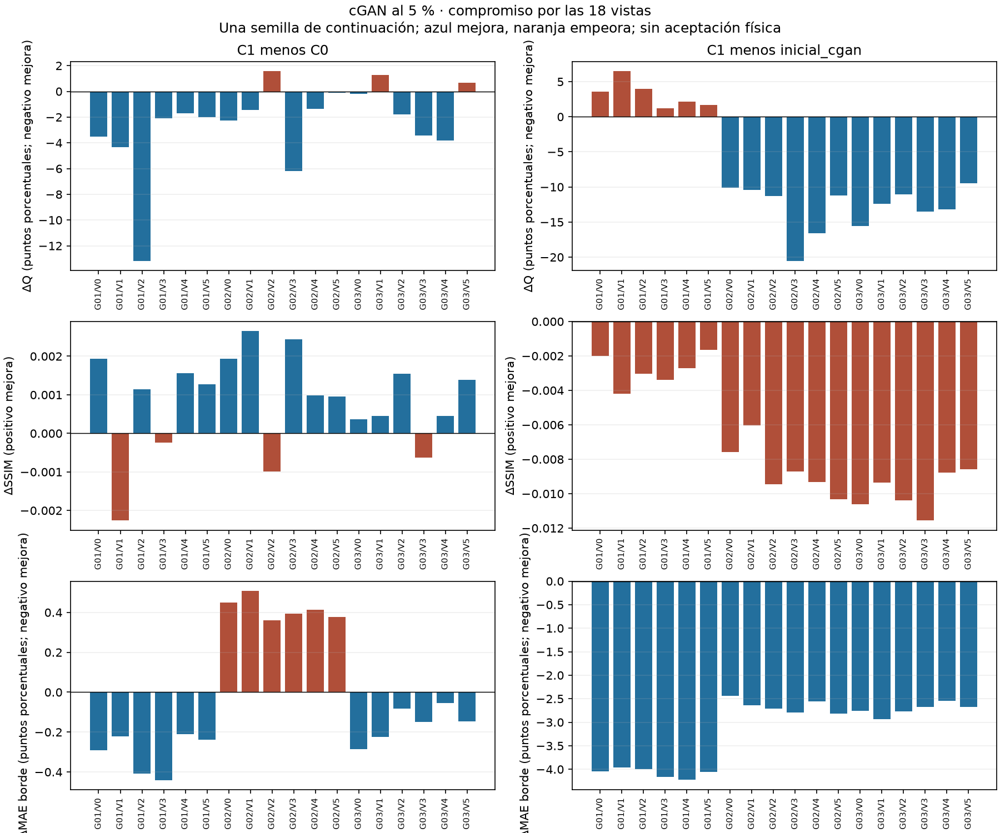

# Valoración del compromiso de la continuación cGAN

Fecha: 2026-10-04, America/Bogota. **Decisión: C1 es una candidata para estudiar la estabilidad de la continuación; no se acepta todavía como solución física general ni se amplía la campaña.** Se conservan la regla descriptiva y los datos de validación del diseño original.

## Evidencia y unidades de comparación

Se utilizan los pesos y predicciones de la [entrega CG-04c verificada](REVISION_BINARIOS_CG04C.md). Se revisan las 18 vistas de tres geometrías, con veinte realizaciones por vista, y las 24 combinaciones de vista/anomalía. No se entrenó ni se abrieron test/generalization. Las 18 vistas no son 18 geometrías independientes; las realizaciones de conteo no son semillas de entrenamiento.

Se reconstruyó el detalle del modelo inicial desde sus predicciones verificadas. Los promedios por vista reproducen Q, SSIM, PSNR y errores de cielo/borde publicados, con diferencias inferiores a 1e-12. Se conserva la distinción entre magnitud del sesgo medio y media de las magnitudes del sesgo.

Para cada vista se utiliza la contribución al indicador original:

\[q_{g,v}=\frac12\left(|\overline B_{g,v,\mathrm{roca}}|+\frac1{J_g}\sum_j|\overline B_{g,v,j}|\right),\qquad Q_g=\frac16\sum_v q_{g,v},\qquad Q=\frac13\sum_g Q_g.\]

Los contrastes mantienen el emparejamiento geométrico y las 23 combinaciones comunes con denominador definido en las veinte realizaciones. La combinación restante se conserva en el archivo completo; no se incorporan pseudoconteos.

## Qué mejora y qué empeora

| Medida de C1 | Mejora frente a C0 | Empeora frente a C0 | Mejora frente al inicial | Empeora frente al inicial |
|---|---:|---:|---:|---:|
| q por vista | 15/18 | 3/18 | 12/18 | 6/18 |
| SSIM por vista | 14/18 | 4/18 | 0/18 | 18/18 |
| PSNR por vista | 17/18 | 1/18 | 0/18 | 18/18 |
| Error de cielo por vista | 14/18 | 4/18 | 18/18 | 0/18 |
| Error de borde por vista | 12/18 | 6/18 | 18/18 | 0/18 |
| Error absoluto de contraste | 12/23 | 11/23 | 11/23 | 12/23 |

El Q global cae de 7,204 % en C0 a 4,765 % en C1. La mejora global no implica uniformidad: q empeora en geo-val-02/V2 (+1,563 puntos porcentuales), geo-val-03/V1 (+1,274) y geo-val-03/V5 (+0,674). Los índices V0–V5 son los índices originales del repositorio.

El error de borde de C1 empeora frente a C0 en **las seis vistas de geo-val-02**. La mejora global de borde es pequeña: 11,27849 % a 11,26486 %, solo 0,01360 puntos porcentuales. Supera el redondeo de la reproducción, pero una sola semilla no demuestra que sea estable frente a la variación del entrenamiento.

Frente al modelo inicial, C1 mejora q en geo-val-02 y geo-val-03 y lo empeora en las seis vistas de geo-val-01. SSIM y PSNR empeoran en las 18 vistas. Frente a la entrada sin red, C1 mejora SSIM/PSNR en las 18 vistas, pero tiene peor q en 14: reducción de ruido y conservación regional no son equivalentes.

[Figura en PDF](figuras/compromiso-cgan-vistas.pdf) · [Tabla completa por vista y modelo](evidencias/compromiso-cgan-vistas.csv) · [Evidencia completa, incluidas anomalías y contrastes](evidencias/compromiso-cgan.json). Azul indica mejora nominal y naranja deterioro; cada panel declara el signo favorable.

## Anomalías que impiden una aceptación general

Se confirman ocho deterioros de magnitud del sesgo medio frente a C0 y cinco frente al inicial, entre las 24 combinaciones. Los casos de mayor sesgo de C1 se concentran en el cuerpo denso de geo-val-03:

| Vista | Sesgo medio C1 | Cambio de magnitud frente a C0 | Referencia regional | Píxeles |
|---|---:|---:|---:|---:|
| V5 | 28.19 % | 2.98 puntos porcentuales | 210 cuentas | 524 |
| V2 | 27.64 % | -4.77 puntos porcentuales | 163 cuentas | 379 |
| V1 | 23.82 % | 7.00 puntos porcentuales | 257 cuentas | 558 |
| V4 | 15.24 % | -15.34 puntos porcentuales | 144 cuentas | 362 |

Un cambio positivo en la tercera columna es deterioro. El soporte y las cuentas se mantienen visibles: porcentajes altos con pocas cuentas no se interpretan sin ese contexto, ni se eliminan para mejorar el promedio.

Hay nueve inversiones del signo del contraste medio de C1 frente a la referencia entre las 23 combinaciones comunes. Varias referencias están cerca de cero y el signo aislado no mide relevancia física. Sin embargo, en geo-val-03/V1/cuerpo denso el contraste de referencia es −0,11257 y el predicho medio +0,15642. Esta alteración del contraste muográfico merece seguimiento explícito; no se convierte en una afirmación sobre reconstrucción de densidad.

## Valoración y decisión

La clasificación original **mejora_concordante_descriptiva** de C1 frente a C0 se conserva: responde a ocho criterios agregados fijados antes del ensayo. El análisis por vista y anomalía añade límites de interpretación, sin modificar retrospectivamente esa clasificación.

El compromiso resulta suficiente para justificar una prueba acotada de estabilidad del término regional, pero insuficiente para sustituir al modelo inicial como solución universal, declarar aceptación física o cerrar el OE2. No se fija a posteriori un umbral de pérdida de SSIM, PSNR o contraste que convierta el resultado observado en aceptable.

Se mantienen ambos tipos de evidencia: ganancia regional frente a C0 y deterioros localizados frente a C0/inicial. La recomendación es repetir el contraste C0/C1 con semillas de continuación nuevas, conservando todos los demás parámetros, según el [diseño de repetición](DISENO_REPETICION_CGAN_F05.md). Si los defectos se mantienen, repetir más veces no los resuelve: será necesaria una revisión del diseño científico.

## Reproducción

El [analizador](herramientas/analizar_compromiso_cgan.py) recibe `--comparacion`, `--anomalias`, `--predicciones-iniciales`, `--datos`, `--mascaras` y `--salida`. Las tres primeras rutas corresponden a la entrega CG-04c ya verificada; la salida debe ser nueva. Genera JSON, CSV, PNG y PDF. Comprueba la huella de las predicciones iniciales, la integridad del contrato y máscaras, la igualdad de los resúmenes y la conservación de los 360 índices val. No realiza inferencia nueva ni entrenamiento.
