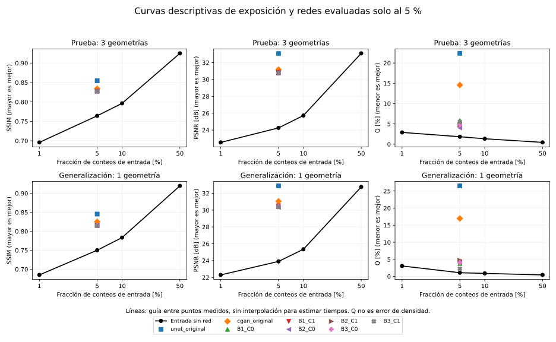

# OE3: curvas descriptivas de exposición

**Revisión directa de la propuesta aprobada — 2026-10-04:** se verificaron las fases 3 y 4: requieren detectabilidad local (incluida SNR), evaluación de redes a distintas fracciones y umbrales de calidad predefinidos, sin valores operativos fijados en el PDF. El desglose al 5 % conserva su validez, pero no completa esos compromisos. [Revisión y pendientes OE3-P05/P06](../docs/REVISION_PROPUESTA_APROBADA.md). No se exige campaña de campo; se mantiene aplazada la redacción del informe final.

**Desglose experimental ejecutado:** [comparación por vista y región](RESULTADO_EXPERIMENTAL_OE3.md). La cGAN al 5 % supera SSIM/PSNR de la entrada al 10 % en 24/24 vistas y 480/480 correspondencias, con deterioro de Q en 24/24 vistas. Se cuantifica una reducción descriptiva 2:1 de conteos bajo esas métricas; no un factor físico aceptado ni el máximo alcanzable. No se requiere otra GPU para reproducir este balance. La redacción del informe final se aplaza hasta concluir la revisión experimental, por indicación de la dirección.

2026-10-04, Colombia. Análisis de la dirección sobre el catálogo ya disponible, posterior a la evaluación final del OE2. Base del repositorio: `1214307c525ace12c978ede5336fcf893abad7c7`. Se amplía la preparación del OE3 por solicitud de continuar el trabajo local; la redacción oficial del objetivo sigue pendiente de confirmación. No se declara su cumplimiento.

## Pregunta y método

Se estudia cómo varía la calidad de las imágenes **sin red** al utilizar 1 %, 5 %, 10 % y 50 % de los conteos y se compara con las ocho redes existentes, evaluadas exclusivamente al 5 %. No se entrenan redes en nuevas fracciones ni se generan muones.

Para cada imagen de conteos bajos n_f se utilizan cuentas equivalentes n_f/f y la normalización fijada por entrenamiento. La referencia y las regiones se conservan. Se recalcularon 1.920 registros de imagen, 504 registros regionales y 216 registros de contraste. El caso f = 0,05 reproduce SSIM, PSNR y Q de la entrada en EF-01-C2 con tolerancia 10⁻¹². Cuatro pruebas controlan cruces entre puntos, límites sin extrapolación y rechazo de curvas no monótonas o valores inválidos.

Los valores de prueba son promedios con igual peso entre sus tres geometrías; generalización contiene una sola geometría. Se conservan resultados por geometría y por imagen. Los controles de contraste se reproducen desde el registro C2, sin volver a seleccionarlos. Las cuatro fracciones proceden de los mismos archivos cuyo SHA-256 se verifica antes del cálculo.

## Resultados

| Partición | Conteos | SSIM | PSNR (dB) | Q (%) |
|---|---:|---:|---:|---:|
| test | 1 % | 0.6959 | 22.537 | 2.897 |
| test | 5 % | 0.7643 | 24.258 | 1.832 |
| test | 10 % | 0.7964 | 25.722 | 1.334 |
| test | 50 % | 0.9250 | 33.101 | 0.437 |
| generalization | 1 % | 0.6851 | 22.299 | 3.067 |
| generalization | 5 % | 0.7502 | 23.904 | 1.093 |
| generalization | 10 % | 0.7834 | 25.349 | 0.895 |
| generalization | 50 % | 0.9197 | 32.752 | 0.449 |




Figura: métricas por partición. Las líneas unen valores medidos como guía visual; no se usan para interpolar factores de adquisición. Todos los símbolos de redes se ubican en 5 %, la única fracción de entrada evaluada para ellas. Las continuaciones se muestran completas, sin seleccionar la mejor semilla.

En prueba, la **cGAN original al 5 %** obtiene SSIM 0,8342 y PSNR 31,170 dB, superiores a 0,7964 y 25,722 dB de la entrada sin red al 10 %. Sin embargo, Q pasa de 1,334 % en esa entrada al 10 % a 14,566 % en la cGAN al 5 %. La mejora de similitud no implica conservar mejor las cuentas. Q no es error de densidad ni un error global de todos los píxeles.

Las seis continuaciones también superan, en estos promedios, SSIM y PSNR de la entrada al 10 %, pero conservan peor las cuentas según Q. U-Net ofrece los valores visuales mayores y un Q aún mayor. Estas diferencias no son una prueba de superioridad estadística; las realizaciones de una misma geometría no se tratan como geometrías independientes.

## Qué se puede decir del tiempo

Bajo flujo estable y condiciones de detección iguales, E[N(t)] = λt. Para una red alimentada con f_modelo = 0,05 y una entrada comparadora f_raw, la razón nominal entre exposiciones es R = f_raw/0,05. Frente al 10 % corresponde a 2; frente al 50 %, a 10; frente a la referencia completa, a 20. Estas razones describen fracciones de conteos, no tiempos medidos ni factores físicamente aceptados.

En los macropromedios de prueba, las ocho redes quedan entre los valores de la entrada al 10 % y al 50 % tanto en SSIM como en PSNR. En generalización ocurre lo mismo, salvo que el PSNR de U-Net supera ligeramente el de la entrada al 50 % (32,883 frente a 32,752 dB); su SSIM permanece por debajo. Se registran también los cruces por geometría, que no deben sustituirse por el promedio.

La rejilla sitúa los cruces visuales entre puntos asociados nominalmente a 2 y 10 respecto del 5 %, pero **no estima un factor entre 2× y 10×, un máximo alcanzable ni un intervalo de confianza**. No hay mediciones intermedias ni se adopta una ley de interpolación. En U-Net/generalización/PSNR el cruce queda fuera de la rejilla; no se extrapola. Tampoco se utiliza la referencia comparada consigo misma como un punto PSNR infinito para forzar un cruce.

Una conclusión descriptiva válida es que las redes al 5 % superan determinadas métricas de una entrada con el doble de conteos, con deterioro de otros indicadores. No es válido convertir ese resultado en equivalencia física, en una reducción efectiva de 20 veces ni en una afirmación de desempeño del modelo al 1 %, 10 % o 50 %.

## Contraste: soporte común y exclusiones explícitas

Para comparar las cuatro fracciones y las ocho redes se usa soporte común completo. Al 1 % algunas realizaciones tienen control nulo; la intersección conserva **21 combinaciones en prueba y 11 en generalización**, frente a 30 y 16 en C2. Por ello, los promedios de contraste de este análisis no deben compararse directamente con los promedios C2 que usaban otro soporte. El JSON incluye los resultados de las redes recalculados sobre la misma intersección, las claves exactas y los 216 registros completos, incluidos los no estimables. SSIM, PSNR y Q no se filtran por este soporte de contraste.

## Límites y estado

Las referencias son de alta estadística finita, con ruido; las imágenes reducidas se derivan de ellas y no son exposiciones de campo independientes. El catálogo y resultados históricos eran conocidos. Se trata de análisis descriptivo posterior a la apertura de las reservas, no de validación confirmatoria ni de una selección de modelo. No se fijó un umbral retrospectivo para garantizar éxito.

| Pendiente | Estado | Criterio |
|---|---|---|
| OE3-P01: curvas disponibles | verificado | Cuatro fracciones, todos los casos reservados, control f05 y código reproducible. |
| OE3-P02: alcance y calidad aceptable | parcial | Propuesta aprobada leída directamente; criterios operativos aún por justificar. No se fijan umbrales retrospectivos para asegurar aceptación. |
| OE3-P03: factor alcanzable | parcial | Desglose ejecutado: razón descriptiva 2:1 bajo SSIM/PSNR en todas las vistas; 10:1 no respaldado conjuntamente. Factor físico y máximo no demostrados. |
| OE3-P04: manuscrito | pendiente | Aplazado por indicación de la dirección hasta culminar revisión experimental; no se solicita redacción a los estudiantes en esta etapa. |

No se solicita otra campaña ni entrenamiento. La indicación anterior de incorporar el manuscrito queda aplazada por la dirección; primero se completa la revisión experimental. La dirección debe confirmar la formulación oficial y el criterio científico antes de afirmar un factor alcanzable; si no se demuestra bajo ese criterio, se reportará esa limitación. El cierre técnico de la entrega OE2 no cambia por este análisis.

## Evidencia y reproducción

- [Curvas, cruces por métrica/geometría y metadatos](evidencias/curvas-v1/curvas.json).
- [1.920 registros de imagen](evidencias/curvas-v1/imagenes.csv), [504 regionales](evidencias/curvas-v1/regiones.csv) y [216 contrastes](evidencias/curvas-v1/contrastes.json).
- [Código](herramientas/curvas_exposicion_descriptivas.py), [pruebas](herramientas/test_curvas_exposicion_descriptivas.py) y [generador de figura](herramientas/figura_curvas.py).
- [Inventario de archivos publicados](evidencias/curvas-v1/inventario.json).

Se usa el entorno del evaluador OE2, con NumPy, PyTorch, scikit-image y Matplotlib. No requiere GPU. Desde la raíz del repositorio:

```bash
python objetivo-3/herramientas/test_curvas_exposicion_descriptivas.py
python objetivo-3/herramientas/curvas_exposicion_descriptivas.py \
  --repo . --data /ruta/insumos \
  --registry objetivo-2/evidencias/ef01-c2/controles.json \
  --c2-report objetivo-2/evidencias/ef01-c2/resultados.json \
  --out /ruta/nueva/curvas
python objetivo-3/herramientas/figura_curvas.py \
  --curves /ruta/nueva/curvas/curvas.json \
  --models objetivo-2/evidencias/ef01-c2/resultados.json \
  --output-dir /ruta/nueva/curvas
```

El adaptador de fracción pasa n_f·(0,05/f) al evaluador histórico, que divide por 0,05, y verifica numéricamente su equivalencia con n_f/f. No altera los archivos originales. Se conserva el caso completo del 5 % como control positivo. El informe incluye huellas y entorno; diferencias de finales de línea en copias de JSON pueden cambiar su huella documental sin cambiar los valores. Las fuentes congeladas y el registro de controles sí se verifican con las huellas exigidas por EF-01-C2.

## Ruta de continuidad desde el OE2

Actualización documental: 2026-10-04, Colombia. Se incorpora la [precisión del balance OE2](../objetivo-2/CIERRE_OE2.md#precisión-sobre-calidad-comparable-y-continuidad-al-oe3), que documenta mejora de SSIM/PSNR de la cGAN al 5 % frente a la entrada al 10 % en el promedio de las cuatro geometrías. Este avance no demuestra equivalencia con la referencia completa ni cierra automáticamente OE3.

El trabajo puede continuar con los archivos disponibles y sin otra campaña GPU. Se propone la siguiente secuencia para los pendientes ya registrados:

1. **OE3-P02 — Delimitar calidad y alcance.** Contrastar la formulación comunicada del objetivo con la propuesta aprobada y sus métricas. Distinguir calidad de imagen según SSIM/PSNR de conservación regional y contraste. No imponer una condición nueva como si fuera original ni adoptar un margen retrospectivo para asegurar éxito. Si no hay margen fundamentado, mantener una comparación descriptiva explícita.
2. **OE3-P03 — Completar el desglose.** Las curvas por fracción y geometría ya existen. Sintetizar resultados por vista y región, manteniendo todos los modelos y casos desfavorables. Los análisis adicionales sobre esos resultados son posteriores a su observación; no constituyen una nueva reserva independiente ni deben usar las veinte realizaciones como geometrías independientes.
3. **OE3-P03 — Informar la reducción respaldada por cada indicador.** Comparar la salida al 5 % con las entradas existentes al 10 % y al 50 %, usando la misma referencia, normalización y soporte común de contraste. La razón nominal 10/5 = 2 acompaña una mejora descriptiva de SSIM/PSNR; no representa por sí sola un factor de adquisición físicamente aceptado. No interpolar un máximo entre fracciones ni convertir automáticamente 1/0,05 = 20 en factor alcanzado.
4. **OE3-P04 — Redactar resultados y conclusión.** Integrar tablas, figuras, supuestos de flujo/detección y límites. Si los criterios difieren, informar factores o comparaciones por métrica, sin un único número que oculte deterioros. Si no puede demostrarse un factor bajo un criterio justificado, consignarlo como resultado del estudio.

La revisión de criterio y la síntesis pueden realizarse con la evidencia conservada; la integración del manuscrito queda aplazada por indicación de la dirección. Cualquier nueva corrida dependería de una pregunta experimental específica que este análisis no pueda responder. La ruta anterior conserva la secuencia propuesta. Actualización: el desglose por vista/región y la comparación de las fracciones ya se ejecutaron en el registro enlazado al inicio; la tolerancia física y el informe final siguen pendientes.

## Pendientes identificados en la propuesta

- **OE3-P05, pendiente:** evaluación de redes con distintas fracciones de entrada; las curvas sin red no la sustituyen.
- **OE3-P06, pendiente:** SNR local y correspondencia entre contraste de cuentas y contraste de opacidad.

Criterios de cierre y secuencia en la [revisión de propuesta](../docs/REVISION_PROPUESTA_APROBADA.md). P03 queda condicionado a estos análisis y P02; no se inicia automáticamente otra campaña.
