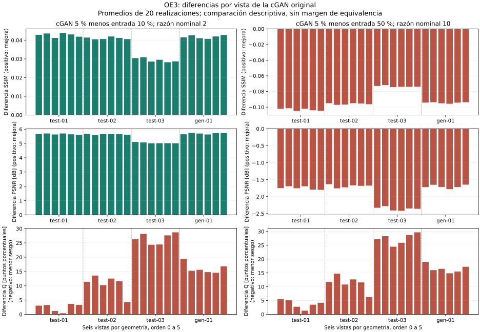

# OE3: comparación por vista y región y reducción descriptiva de conteos

**Revisión directa de la propuesta aprobada — 2026-10-04:** se verificaron las fases 3 y 4: requieren detectabilidad local (incluida SNR), evaluación de redes a distintas fracciones y umbrales de calidad predefinidos, sin valores operativos fijados en el PDF. El desglose al 5 % conserva su validez, pero no completa esos compromisos. [Revisión y pendientes OE3-P05/P06](../docs/REVISION_PROPUESTA_APROBADA.md). No se exige campaña de campo; se mantiene aplazada la redacción del informe final.

Fecha de análisis: 2026-10-04, Colombia. Actividad de revisión de la dirección sobre resultados estudiantiles conservados. Este documento es un registro del análisis experimental, no un capítulo del informe final. No se realizaron nuevas simulaciones, entrenamientos ni inferencias.

## Pregunta y alcance

Se estudia si las redes alimentadas con el 5 % de los conteos alcanzan o superan indicadores de imágenes sin procesar que contienen una fracción mayor. Se utilizan los ocho modelos congelados del OE2, sin seleccionar una semilla favorable después de abrir prueba. Se compara con las fracciones existentes 1 %, 5 %, 10 % y 50 %; las dos primeras sirven como contexto y control, las últimas permiten estudiar reducciones nominales 2:1 y 10:1 respecto del 5 %.

La formulación del OE3 comunicada por la dirección consiste en evaluar el modelo y determinar el factor de reducción de adquisición mediante comparación con exposiciones prolongadas. Aquí se obtiene una comparación descriptiva basada en el submuestreo sintético disponible. No se presenta como un experimento nuevo con exposiciones de campo independientes ni como una medición de horas ahorradas.

## Método y controles

Se reutilizaron los CSV de imagen y regiones de la entrega final, que C2 conservó, y los contrastes corregidos C2. Los siete archivos fuente se contrastaron con la versión publicada: [procedencia Git](evidencias/desglose-v1/procedencia-git.json). Los archivos originales no se modificaron. Las huellas de las copias locales figuran en [resultado completo](evidencias/desglose-v1/resultado.json); pueden variar por finales de línea sin cambiar valores.

Para cada modelo y fracción comparadora se emparejaron geometría, vista y número de realización. Cada vista contiene veinte realizaciones. Las métricas de imagen son SSIM y PSNR con la normalización T del OE2, comparadas siempre con la misma referencia de alta estadística. Se mantienen las medidas de sesgo y error espacial en cuentas inversamente transformadas, así como el indicador regional Q; Q no representa error de densidad. Los promedios se calculan por vista, sin tratar las realizaciones como geometrías independientes.

Se comprobó unicidad y soporte completo: 480 imágenes, 126 combinaciones región/vista y 24 vistas por método o fracción. Las regiones mantienen familia, número de píxeles y suma de referencia entre métodos. El control f = 0,05 reproduce la entrada C2. Se reprodujeron además 78 valores agregados de SSIM, PSNR y Q publicados anteriormente. Cuatro pruebas funcionales verifican sentido de las métricas, empates numéricos, rechazo de duplicados y datos no finitos. El resumen es idéntico al usar los CSV de la entrega publicada o los CSV recalculados en la auditoría C2.

El signo de la diferencia candidato menos comparador determina mejora o deterioro, con tolerancia aritmética de 10⁻¹². Esa tolerancia no es un margen de equivalencia física ni una tolerancia de aplicación. La comparación conjunta de indicadores se usa como diagnóstico exploratorio posterior a la evaluación; no se introduce como condición original de aceptación del objetivo.

Para contraste se conserva la intersección ya documentada de todos los modelos y las cuatro fracciones: 32 combinaciones anomalía/vista, 21 de prueba y 11 de generalización, distribuidas en 22 vistas. Se conservan explícitamente 22 registros fuera de esta intersección entre los 54 posibles. Incluyen seis no estimables geométricamente y otros con alguna realización sin control válido. No se eliminan esas vistas de SSIM, PSNR o regiones. El soporte más restrictivo también depende de la fracción 1 %; no se escoge un soporte distinto para favorecer 10 % o 50 %. Los errores de contraste se promedian sobre el mismo soporte en cada comparación.

## Resultado principal de la cGAN original

| Comparación con cGAN al 5 % | Entrada al 10 % | Entrada al 50 % |
|---|---:|---:|
| Razón nominal de conteos del comparador respecto de la red | 2 | 10 |
| Vistas que mejoran simultáneamente SSIM y PSNR | 24/24 | 0/24 |
| Correspondencias por realización que mejoran ambas métricas | 480/480 | 0/480 |
| Vistas sin aumento de Q | 0/24 | 0/24 |
| Vistas sin mayor error de contraste, en soporte común | 21/22 | 0/22 |

Las diferencias de SSIM y PSNR frente al 10 % son positivas en todas las vistas: el mínimo incremento es 0,028233 de SSIM y 5,018434 dB de PSNR. Frente al 50 %, ambas métricas son inferiores en todas las vistas. Por tanto, el resultado favorable no depende de un único promedio de geometrías. Las 480 correspondencias no constituyen 480 ensayos independientes y no se utilizan para declarar significación estadística.

La figura muestra la distribución por vista. En Q, una diferencia positiva indica peor conservación del promedio regional; el signo favorable es el opuesto al de SSIM y PSNR. Los límites verticales de los paneles son diferentes y están indicados: la altura visual de barras de distintos paneles no debe compararse sin leer la escala.



## Resultado regional: dónde mejora y dónde empeora

El siguiente cuadro cuenta regiones/vista en las que cGAN al 5 % no empeora frente a la entrada al 10 %. El sesgo medio compara el valor absoluto del promedio firmado de veinte realizaciones. El sesgo absoluto por realización promedia sus valores absolutos. El error espacial suma diferencias absolutas por píxel y divide por cuentas de referencia; no es equivalente a ninguno de los dos sesgos.

| Familia | Sesgo medio | Sesgo absoluto por realización | Error espacial |
|---|---:|---:|---:|
| Cielo | 0/24 | 0/24 | 0/24 |
| Roca sin anomalía | 0/24 | 0/24 | 24/24 |
| Borde | 1/24 | 0/24 | 0/24 |
| Anomalías | 2/54 | 8/54 | 54/54 |

La reducción del error espacial en roca y anomalías muestra una mejora adicional a SSIM/PSNR. Al mismo tiempo, el sesgo de sus promedios puede empeorar: reducir ruido no garantiza conservar el total regional. Las 54 regiones de anomalía no son 54 escenarios independientes. Frente al 50 %, ninguna región mejora o empata el error espacial; los conteos completos quedan disponibles, sin ocultar las excepciones de sesgo.

En contraste frente al 10 %, la vista desfavorable es geo-test-03, vista 2. Dos vistas carecen de soporte común completo y no se cuentan como éxitos ni como ceros. La comparación favorable en 21/22 vistas tampoco prueba detectabilidad ni exactitud de densidad. Se conservan por anomalía los errores y el número de inversiones de signo en [contrastes.csv](evidencias/desglose-v1/contrastes.csv).

## Control frente a todos los modelos congelados

La siguiente tabla conserva las ocho redes. «Sin deterioro conjunto» exige que no empeoren las dos métricas de imagen, Q, los cuatro promedios espaciales de familia y el contraste estimable. Se utiliza exclusivamente para localizar compromisos; no es una prueba estadística de equivalencia ni una nueva puerta de aprobación.

| Modelo | Vistas SSIM/PSNR frente a 10 % | Vistas SSIM/PSNR frente a 50 % | Sin deterioro conjunto frente a 10 % |
|---|---:|---:|---:|
| unet_original | 24/24 | 0/24 | 0/24 |
| cgan_original | 24/24 | 0/24 | 0/24 |
| B1_C0 | 24/24 | 0/24 | 0/24 |
| B1_C1 | 24/24 | 0/24 | 0/24 |
| B2_C0 | 24/24 | 0/24 | 0/24 |
| B2_C1 | 24/24 | 0/24 | 0/24 |
| B3_C0 | 24/24 | 0/24 | 0/24 |
| B3_C1 | 24/24 | 0/24 | 3/24 |


Las ocho redes superan ambas métricas de imagen frente al 10 % en todas las vistas, y ninguna lo hace simultáneamente frente al 50 %. B3_C1 tiene tres vistas sin deterioro conjunto frente al 10 %, pero no un resultado uniforme en las 24. Esas tres vistas no justifican escoger esa semilla como ganadora ni eliminar las restantes. La afirmación de mejoría se mantiene separada por indicador y modelo.

## Qué factor puede informarse

Si flujo, geometría, eficiencia y condiciones de detección permanecen constantes, la esperanza de cuentas es proporcional al tiempo: E[N(t)] = λt. Para una entrada comparadora de fracción f y una red alimentada con 0,05, la razón nominal es R = f/0,05. Bajo esa correspondencia idealizada, el caso f = 0,10 representa dos veces los conteos y dos veces la exposición nominal.

**Resultado respaldado:** en este catálogo, la cGAN al 5 % supera las imágenes sin procesar al 10 % en SSIM y PSNR en las 24 vistas evaluadas. Se respalda una reducción descriptiva 2:1 de conteos bajo esos dos indicadores, respecto del comparador al 10 %, condicionada al esquema de submuestreo. No es una equivalencia con la referencia completa ni un ahorro temporal medido en un detector real.

**Resultado no respaldado:** no se demuestra reducción 10:1 bajo ambas métricas, ni reducción 20:1 frente a calidad de referencia, ni un factor que preserve conjuntamente todos los indicadores regionales. Tampoco se determina el máximo entre 2 y 10: no se interpolan valores de exposición ni se supone que las métricas de redes varían monótonamente en fracciones que no recibieron como entrada.

La razón 2:1 es la mayor de las dos razones mayores que uno ensayadas que satisface la comparación visual en todas las vistas. Se trata del máximo de esa rejilla discreta para esta regla descriptiva, no del máximo físico alcanzable. No debe reemplazarse esta distinción por un único número de «reducción demostrada» sin especificar métrica, referencia y condiciones.

## Balance experimental y siguiente decisión

El desglose pendiente por vistas y regiones queda ejecutado. La comparación de exposición existente queda concluida para el alcance descrito; no requiere otra GPU, más épocas ni repetir la entrega estudiantil. Se mantiene la decisión de terminar la revisión experimental antes de redactar el libro o informe final.

El desempeño y la reducción condicionada a SSIM/PSNR están cuantificados. La parte de factor de adquisición físicamente aceptado continúa sin demostrarse, porque persisten errores regionales y no existe un margen de aplicación justificado previamente. Esta limitación no se resuelve repitiendo inferencias o incrementando épocas sin una hipótesis concreta. No se declara cerrado plenamente el OE3.

Antes de una nueva campaña, la decisión científica es si el alcance aceptado corresponde a mejora de imagen bajo las métricas de la propuesta o si requiere conservar cuentas dentro de una tolerancia de aplicación. Para el primer alcance ya existe el resultado descriptivo 2:1, con las limitaciones anteriores. Para el segundo sería necesario definir y justificar esa tolerancia y diseñar una validación adicional; cualquier criterio nuevo se declararía posterior a los resultados existentes. No se ha encargado esa campaña a los estudiantes ni se ha redactado el informe final.

## Evidencia y reproducción sin GPU

Se publican 768 filas de vista, 4.032 filas regionales y 1.024 filas de contraste: incluyen cuatro fracciones y ocho modelos sobre los mismos casos, no observaciones independientes nuevas. [Resumen](evidencias/desglose-v1/resumen.csv) · [Vistas](evidencias/desglose-v1/vistas.csv) · [Regiones](evidencias/desglose-v1/regiones.csv) · [Resultado y controles](evidencias/desglose-v1/resultado.json).

El [analizador](herramientas/comparar_exposiciones_oe3.py) utiliza solo la biblioteca estándar de Python; se ejecutó con Python 3.12.14 en Windows. La [figura](herramientas/figura_desglose_oe3.py) utiliza Matplotlib 3.11.1. La generación y revisión visual fueron satisfactorias. Las [pruebas](herramientas/test_comparar_exposiciones_oe3.py) verifican los controles descritos.

Para reproducir desde la raíz del repositorio, crear una carpeta de trabajo nueva, copiar en ella los dos CSV originales y guardar la síntesis C2 con el nombre que espera el analizador. Esta operación conserva los originales:

```powershell
New-Item -ItemType Directory trabajo/oe3-insumos
Copy-Item objetivo-2/entregas/2026-10-04-evaluacion-final-f05/datos/evaluacion-final-f05/informe-v1/imagenes.csv trabajo/oe3-insumos/imagenes.csv
Copy-Item objetivo-2/entregas/2026-10-04-evaluacion-final-f05/datos/evaluacion-final-f05/informe-v1/regiones.csv trabajo/oe3-insumos/regiones.csv
Copy-Item objetivo-2/evidencias/ef01-c2/resultados.json trabajo/oe3-insumos/evaluacion-final.json
python objetivo-3/herramientas/test_comparar_exposiciones_oe3.py
python objetivo-3/herramientas/comparar_exposiciones_oe3.py --c2 trabajo/oe3-insumos --curvas objetivo-3/evidencias/curvas-v1 --salida trabajo/oe3-desglose
python objetivo-3/herramientas/figura_desglose_oe3.py --vistas trabajo/oe3-desglose/vistas.csv --salida trabajo/oe3-desglose
```

La salida del analizador debe ser un directorio inexistente para evitar sobrescrituras. Los contrastes se leen exclusivamente de C2; el informe de contraste original de los estudiantes no se utiliza en su lugar. El historial conserva la exposición previa del catálogo, la referencia finita compartida y el carácter posterior y descriptivo del análisis.
